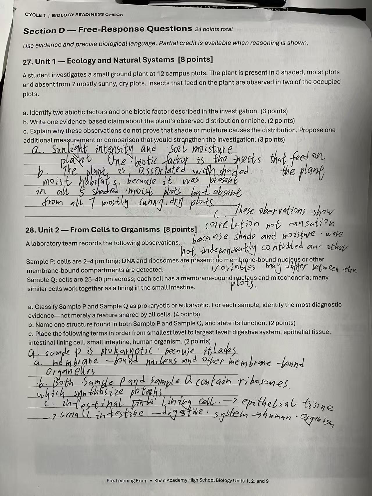
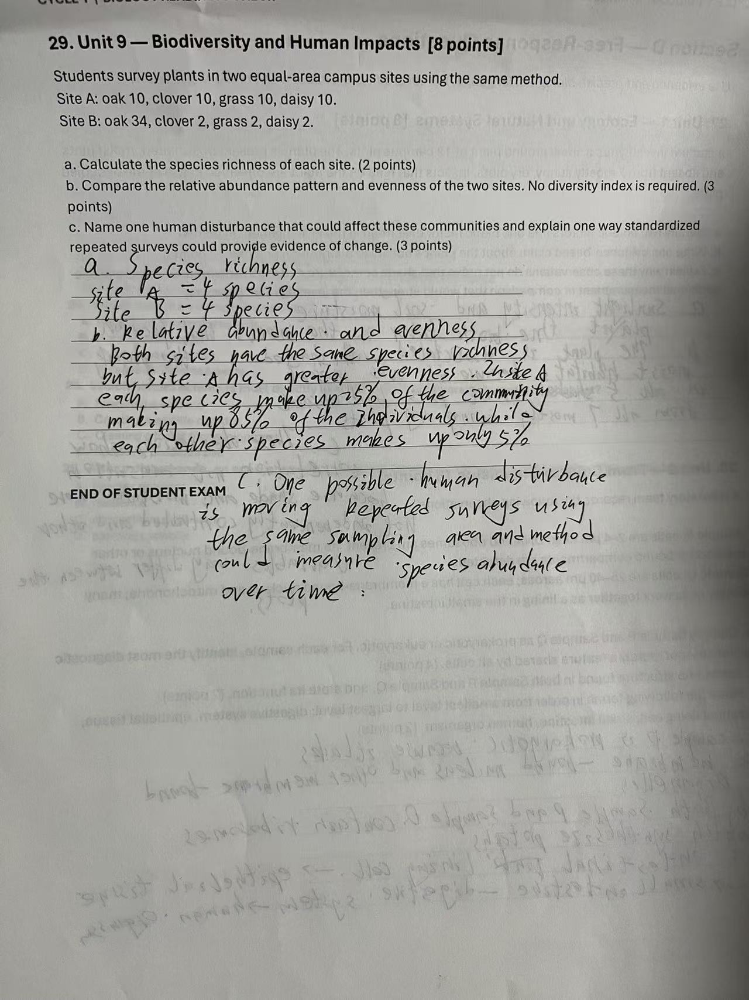
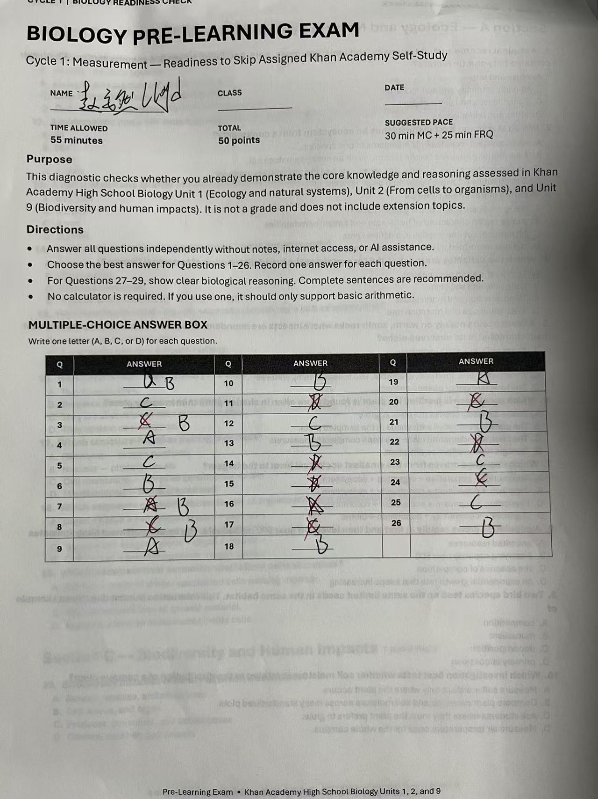

# Biology Unit 2 Learning Journal

## Unit purpose

记录 Khan Academy Biology Unit 2 “From cells to organisms”的学习过程，重点记录细胞、细胞结构、细胞组织层级、器官系统、稳态和反馈调节的理解、错误与修正。

## Progress dashboard

| Topic | Last updated | Next step |
| --- | --- | --- |
| The cellular basis of life | 2026-09-07 | Re-explain cell theory and cell division without prompts. |
| Prokaryotic and eukaryotic cells | 2026-09-07 | Compare the nucleus, nucleoid, chromosomes, and membrane-bound organelles. |
| Parts of eukaryotic cells | 2026-09-07 | Recall each organelle's function from a new diagram. |
| Eukaryotic cell structure and function | 2026-09-07 | Explain structure-function relationships among the rough ER, Golgi, vesicles, and membrane. |
| From cells to organisms | 2026-09-07 | Rebuild the organization hierarchy and tissue functions from memory. |
| Organ system interactions | 2026-09-07 | Trace one process across two interacting organ systems. |
| Homeostasis and feedback loops | 2026-09-07 | Distinguish positive and negative feedback and identify sensor, control center, and effector. |

## Key knowledge and vocabulary

| Concept or term | My current explanation | Example or connection |
| --- | --- | --- |
| Cell | The smallest unit that can perform the basic activities of life. | All organisms are made of one or more cells. |
| Unicellular organism | An organism made of one cell; that cell performs its essential life processes. | An amoeba. |
| Multicellular organism | An organism made of many cells, often with specialized cells. | A human. |
| Cell theory | All organisms are made of one or more cells, and the cell is the basic unit of structure and function. | It applies to both humans and amoebas. |
| Prokaryotic cell | A cell without a membrane-bound nucleus or other membrane-bound organelles. Its DNA is in a nucleoid region. | Bacteria are prokaryotic; cell division produces two individual organisms. |
| Eukaryotic cell | A cell with a membrane-bound nucleus and membrane-bound organelles. | Protists, algae, and human cells are eukaryotic. |
| Nucleoid | The DNA-containing region of a prokaryotic cell; it is not surrounded by a nuclear membrane. | A bacterium has DNA in a nucleoid rather than a nucleus. |
| Nucleus | A membrane-bound organelle that contains genetic material in a eukaryotic cell. | A nucleus is visible in the eukaryotic cell in the comparison micrograph. |
| DNA | The molecule that stores genetic information. | Both bacteria and eukaryotic cells contain DNA, even though its location is organized differently. |
| Chromosome | A DNA-containing structure that carries genetic information. | A bacterium can have a circular chromosome; a eukaryotic cell stores chromosomes in its nucleus. |
| Membrane-bound organelle | A cell structure enclosed by its own membrane. | The nucleus, mitochondria, chloroplasts, and Golgi body are membrane-bound organelles. |
| Organelle | A specialized cell structure that performs a particular function. | Chloroplasts, mitochondria, rough ER, Golgi bodies, and vesicles have different jobs. |
| Ribosome | A structure that builds proteins. | Ribosomes occur in both prokaryotic and eukaryotic cells. |
| Cytoskeleton | A network that helps maintain cell shape and internal organization. | It supports the structure of a eukaryotic cell. |
| Rough endoplasmic reticulum | A ribosome-covered membrane system involved in protein synthesis and modification. | It works with the Golgi body and vesicles to process and transport proteins. |
| Smooth endoplasmic reticulum | A membrane system involved in lipid synthesis. | It differs from rough ER because it lacks ribosomes on its surface. |
| Golgi body | An organelle that modifies, sorts, and directs molecules for transport. | A protein can move from rough ER to Golgi to a vesicle. |
| Vesicle | A membrane-bound sac that transports molecules within or out of a cell. | Vesicles carry processed proteins from the Golgi. |
| Chloroplast | An organelle where photosynthesis occurs. | Palisade cells contain many chloroplasts because they receive light. |
| Mitochondrion | An organelle that generates usable energy for the cell. | It is one of the organelles found in eukaryotic cells. |
| Plasma membrane | The boundary that controls what enters and leaves the cell. | It helps maintain the cell's internal conditions. |
| Cytosol | The fluid internal environment in which many cell processes occur. | It is found in both prokaryotic and eukaryotic cells. |
| Tissue | A group of similar cells that work together. | Epithelial tissue protects; muscle tissue contracts and produces movement. |
| Nervous tissue | Tissue specialized for sensing, processing, and transmitting information. | Nervous tissue helps the body respond to changes. |
| Connective tissue | Tissue that supports, connects, or anchors other tissues and structures. | It can help hold body parts together. |
| Epithelial tissue | Tissue that covers surfaces and protects underlying structures. | Epithelial cells form protective layers such as the lining of the stomach. |
| Muscle tissue | Tissue whose cells contract to produce force and movement. | Muscle activity can generate heat during exercise. |
| Organ | A structure made of multiple tissues working together for a function. | The stomach is an organ in the digestive system. |
| Organ system | A group of organs that work together for a major body function. | The digestive system contains organs that process food and absorb nutrients. |
| Cell differentiation | The process by which cells become specialized, largely through different gene expression. | Ependymal and bipolar neurons can arise from stem cells and express different proteins. |
| Stem-cell potency | The range of cell types into which a stem cell can differentiate. | Different stem cells have different developmental potential. |
| Homeostasis | Maintaining relatively stable internal conditions while conditions change. | All organisms experience homeostasis, but the variables and responses can differ. |
| Feedback loop | A process in which a response changes the original stimulus. | Positive feedback amplifies a stimulus; negative feedback counteracts it. |
| Stimulus | A change in an internal or external condition that can trigger a response. | A rise in body temperature is a stimulus for sweating. |
| Response | A change produced by an organism or its cells after a stimulus. | Sweating is a response that helps cool the body. |
| Positive feedback | A feedback pattern in which the response strengthens the original stimulus. | It can drive a physiological process toward completion. |
| Negative feedback | A feedback pattern in which the response counteracts the original stimulus. | Sweating counteracts an increase in body temperature. |
| Sensor | A component that detects and monitors a condition. | It sends information about a change to the control center. |
| Control center | A component that processes information and coordinates a response. | It receives the sensor signal and directs an effector. |
| Effector | A component that carries out the response to a signal. | An effector can change a physiological process or behavior. |

## Learning records

### Learning record — 2026-09-04 — 细胞是生命的基本单位

#### question

因为细胞是组成生物的最小基本单位

#### respond

核心判断正确。更完整的表述是：细胞是生物体的基本结构单位，也是能够执行全部基本生命活动的最小单位；所有生物都由一个或多个细胞组成。LearningOS 的本地关键词评估将这次中文回答标记为需要重建，但原因是没有匹配到英文参考关键词，不能据此判定概念完全错误。

#### reflection
这次记录把“因为细胞是组成生物的最小基本单位”留下了一个可以继续检查的节点。这条记录是当前 Journal 中较早的一次记录，暂时没有更早的同类条目可比较。原来的反思已经指出：学习者已经回忆出“细胞是组成生物的最小单位”，说明基本结构概念正在形成；目前还没有明确说出细胞能够执行生命活动，因此掌握程度为部分理解。。这条记录目前没有找到可直接对应的结构化 Evidence，所以这里只依据 Journal 原文，不把结果说得比原记录更多。现在能不能算稳定，仍要看下一次独立回答，不能只因为看过解释或写过一次就下结论。下一次不看资料重新回答原问题“因为细胞是组成生物的最小基本单位”，并补一个例子、计算或步骤；如果答不完整，就把缺的那一步单独记下来。

### Learning record — 2026-09-04 — 区分单细胞与多细胞生物

#### question

teach me the current question

#### respond

当前题目要求比较人和变形虫。解题关键是：人是多细胞生物，变形虫是单细胞生物；但是两者的基本结构和功能单位都是细胞，基本生命活动也都发生在细胞中。做表格时先判断“一个细胞还是许多细胞”，再判断细胞是否承担生命活动。

#### reflection
这次记录把“teach me the current question”留下了一个可以继续检查的节点。回看前一条“Learning record — 2026-09-04 — 细胞是生命的基本单位”，当时记录的是“核心判断正确。更完整的表述是：细胞是生物体的基本结构单位，也是能够执行全部基本生命活动的最小单位；所有生物都由一个或多个细胞组成。LearningOS 的本地关键词评估将这次中文…”。原来的反思已经指出：学习者已经理解细胞是生物的最小基本单位，现在需要把这个概念应用到具体例子。；当前重点是避免把“单细胞”误解为“不完整的生物”，并理解单个变形虫细胞可以完成生命活动，而人的许多特化细胞共同维持整体生命。。这条记录目前没有找到可直接对应的结构化 Evidence，所以这里只依据 Journal 原文，不把结果说得比原记录更多。现在能不能算稳定，仍要看下一次独立回答，不能只因为看过解释或写过一次就下结论。下一次不看资料重新回答原问题“teach me the current question”，并补一个例子、计算或步骤；如果答不完整，就把缺的那一步单独记下来。

### Learning record — 2026-09-06 — Khan Academy Unit 2 Practice completion

#### question

#### respond

在 Khan Academy 的 Unit 2 “From cells to organisms”页面完成了全部 9 个 Practice exercise，共 36 道题。此次范围只包括 Practice；视频、文章、Quiz 1–3 和 Unit test 没有被当作已完成的 exercise。每道题提交前保持至少 20 秒间隔。首遍提交中，页面没有判定任何一道概念题错误；最终 Unit 页面显示 `Unit mastery: 100%`，9 个 Practice 技能均为 `proficient`。

#### reflection
这次记录把“”留下了一个可以继续检查的节点。回看前一条“Learning record — 2026-09-04 — 区分单细胞与多细胞生物”，当时记录的是“当前题目要求比较人和变形虫。解题关键是：人是多细胞生物，变形虫是单细胞生物；但是两者的基本结构和功能单位都是细胞，基本生命活动也都发生在细胞中。做表格时先判断“一个细胞还是许多细…”。原来的反思已经指出：这次记录证明 Khan 页面上的练习和当前页面掌握状态，不等同于无提示回忆或迁移能力。；由于没有真实的被判错答案，没有可供第二遍订正的概念错题；因此不把人为制造的错误写进 Journal。。这条记录目前没有找到可直接对应的结构化 Evidence，所以这里只依据 Journal 原文，不把结果说得比原记录更多。现在能不能算稳定，仍要看下一次独立回答，不能只因为看过解释或写过一次就下结论。下一次不看资料重新回答原问题“”，并补一个例子、计算或步骤；如果答不完整，就把缺的那一步单独记下来。

### Learning record — 2026-09-06 — 细胞与细胞器的结构—功能关系

#### question

#### respond

原核细胞没有细胞核，DNA 位于 nucleoid region；真核细胞有细胞核和膜性细胞器。原核、真核细胞都具有细胞质和核糖体。细胞器的功能需要和结构联系起来：细胞骨架维持结构，叶绿体进行光合作用，线粒体产生可用能量，核糖体构建蛋白质，粗面内质网参与蛋白质合成与修饰，光滑内质网合成脂质，高尔基体修饰和分拣分子，囊泡负责运输，细胞膜控制物质进出，细胞核保存遗传物质。

在 Paneth cell 的结构题中，粗面内质网、高尔基体和囊泡共同解释了蛋白质的合成、加工和运输；在 palisade cell 的题中，丰富的叶绿体与其接受光照并进行光合作用的功能相符合。

#### reflection
这次记录把“”留下了一个可以继续检查的节点。回看前一条“Learning record — 2026-09-06 — Khan Academy Unit 2 Practice completion”，当时记录的是“在 Khan Academy 的 Unit 2 “From cells to organisms”页面完成了全部 9 个 Practice exercise，共 36 道题。此次…”。原来的反思已经指出：操作过程中曾出现排序控件暂时顺序不正确、以及一次过期控件引用，均在提交前通过重新观察页面和重新定位控件修正，不应冒充生物学错误。。这条记录目前没有找到可直接对应的结构化 Evidence，所以这里只依据 Journal 原文，不把结果说得比原记录更多。现在能不能算稳定，仍要看下一次独立回答，不能只因为看过解释或写过一次就下结论。下一次不看资料重新回答原问题“”，并补一个例子、计算或步骤；如果答不完整，就把缺的那一步单独记下来。

### Learning record — 2026-09-06 — 从细胞到生物体

#### question

#### respond

生物组织层级从多到少是 organism → organ system → organ → tissue → cell；从少到多的例子是 parietal cell → epithelial tissue → stomach → digestive system。相似细胞共同工作形成 tissue；多个 tissue 共同工作形成 organ；多个 organ 协同形成 organ system。神经组织负责感知、处理和传递信息，结缔组织负责支持和连接，上皮组织提供保护，肌肉组织通过收缩产生运动。

干细胞和分化题的关键是：细胞分化主要体现为基因表达和蛋白质表达不同，而不是细胞失去一部分 DNA。由同一类干细胞产生的 ependymal cell 和 bipolar cell 可以因为表达不同蛋白而承担不同功能。

#### reflection
这次记录把“”留下了一个可以继续检查的节点。回看前一条“Learning record — 2026-09-06 — 细胞与细胞器的结构—功能关系”，当时记录的是“原核细胞没有细胞核，DNA 位于 nucleoid region；真核细胞有细胞核和膜性细胞器。原核、真核细胞都具有细胞质和核糖体。细胞器的功能需要和结构联系起来：细胞骨架维持结…”。原来的反思已经指出：本轮没有真实的学习者概念错答；这里保留的是练习题所暴露的关键关系，而不是把“做对”直接写成独立掌握。。这条记录目前没有找到可直接对应的结构化 Evidence，所以这里只依据 Journal 原文，不把结果说得比原记录更多。现在能不能算稳定，仍要看下一次独立回答，不能只因为看过解释或写过一次就下结论。下一次不看资料重新回答原问题“”，并补一个例子、计算或步骤；如果答不完整，就把缺的那一步单独记下来。

### Learning record — 2026-09-06 — 器官系统与稳态反馈

#### question

#### respond

器官系统相互作用的例子包括：消化系统和循环系统共同运输营养物，内分泌系统和生殖系统共同参与排卵，循环系统和呼吸系统共同完成气体交换，循环系统和免疫系统共同参与炎症反应。

稳态是维持相对稳定的内部条件。Positive feedback 放大原有刺激并推动过程完成；negative feedback 抵消原有刺激，使系统回到较稳定状态。稳态调节可包含生理反应和行为反应。Sensor 监测条件，control center 处理信号并协调反应，effector 执行反应。血钙过低时，骨骼释放钙的过程增加；血糖过高时，胰腺释放的 insulin 不足是不能维持稳态的解释；运动时体温和出汗率都上升，肌肉产热使体温上升，而出汗散热会抵消这种上升。

#### reflection
这次记录把“”留下了一个可以继续检查的节点。回看前一条“Learning record — 2026-09-06 — 从细胞到生物体”，当时记录的是“生物组织层级从多到少是 organism → organ system → organ → tissue → cell；从少到多的例子是 parietal cell → epit…”。本条记录中写到：器官系统相互作用的例子包括：消化系统和循环系统共同运输营养物，内分泌系统和生殖系统共同参与排卵，循环系统和呼吸系统共同完成气体交换，循环系统和免疫系统共同参与炎症反应。 稳态是维持相对稳定的内部条件。Positive feedback 放大原有刺激并推动过程完成；negative feedback 抵消原有刺激，使系统回到较稳定状态。稳态调节可包含生理反应和行为反应。Sens…。这条记录目前没有找到可直接对应的结构化 Evidence，所以这里只依据 Journal 原文，不把结果说得比原记录更多。现在能不能算稳定，仍要看下一次独立回答，不能只因为看过解释或写过一次就下结论。下一次不看资料重新回答原问题“”，并补一个例子、计算或步骤；如果答不完整，就把缺的那一步单独记下来。

### Learning record — 2026-09-06 — 原核细胞和真核细胞

#### question

whats the difference between prokaryotic and eukaryotic cells

#### respond

最重要的区别是：eukaryotic cell 有 membrane-bound nucleus 和 membrane-bound organelles；prokaryotic cell 没有细胞核，DNA 位于 nucleoid region，也没有膜性细胞器。两者都不是“有没有 DNA”的区别，因为两者都有 DNA；两者也都具有 cytoplasm 和 ribosomes。判断图像时，先找 nucleus，再看是否有膜性细胞器，不要只凭细胞大小猜测。

#### reflection
这次记录把“whats the difference between prokaryotic and eukaryotic cells”留下了一个可以继续检查的节点。回看前一条“Learning record — 2026-09-06 — 器官系统与稳态反馈”，当时记录的是“器官系统相互作用的例子包括：消化系统和循环系统共同运输营养物，内分泌系统和生殖系统共同参与排卵，循环系统和呼吸系统共同完成气体交换，循环系统和免疫系统共同参与炎症反应。 稳态是维…”。原来的反思已经指出：这个问题对应 Unit 2 最容易混淆的“有无细胞核”和“有无遗传物质”两个层次；后续应在没有选项时解释 nucleoid 和 nucleus 的差别。。这条记录目前没有找到可直接对应的结构化 Evidence，所以这里只依据 Journal 原文，不把结果说得比原记录更多。现在能不能算稳定，仍要看下一次独立回答，不能只因为看过解释或写过一次就下结论。下一次不看资料重新回答原问题“whats the difference between prokaryotic and eukaryotic cells”，并补一个例子、计算或步骤；如果答不完整，就把缺的那一步单独记下来。

### Learning record — 2026-09-06 — 细胞器为什么要单独学习

#### question

why do we need talk about the organelles specificly since its just a part of the cell

#### respond

细胞器虽然只是细胞的一部分，但不同细胞器承担不同工作，正是这些分工使细胞能够维持生命活动。可以用一条结构—功能链来理解：ribosome 建造蛋白质，rough ER 参与蛋白质合成和修饰，Golgi body 进一步修改和分拣，vesicle 负责运输；chloroplast 进行光合作用，mitochondrion 产生可用能量，plasma membrane 控制物质进出。不要把“都是细胞的一部分”理解为“功能相同”。

#### reflection
这次记录把“why do we need talk about the organelles specificly since its just a part of the cell”留下了一个可以继续检查的节点。回看前一条“Learning record — 2026-09-06 — 原核细胞和真核细胞”，当时记录的是“最重要的区别是：eukaryotic cell 有 membrane-bound nucleus 和 membrane-bound organelles；prokaryotic …”。原来的反思已经指出：常见混淆是把 organelle 当成同义词，或把 rough ER、Golgi 和 vesicle 的工作混为一谈。；回答时需要始终把名称、结构线索和功能放在同一条解释中。。这条记录目前没有找到可直接对应的结构化 Evidence，所以这里只依据 Journal 原文，不把结果说得比原记录更多。现在能不能算稳定，仍要看下一次独立回答，不能只因为看过解释或写过一次就下结论。下一次不看资料重新回答原问题“why do we need talk about the organelles specificly since its just a part of the cell”，并补一个例子、计算或步骤；如果答不完整，就把缺的那一步单独记下来。

### Learning record — 2026-09-06 — 细胞分裂和生物体生长

#### question

why does cell division relates with organism growth

#### respond

在多细胞生物中，细胞分裂会增加细胞数量，因此可以支持生物体生长和组织修复；一次分裂产生两个细胞，并不意味着产生两个独立生物。在单细胞生物中，细胞分裂可能直接产生两个个体，例如一个 bacterium 分裂为两个 individual organisms。要根据题目问的是“细胞数量增加”还是“个体数量增加”来回答。

#### reflection
这次记录把“why does cell division relates with organism growth”留下了一个可以继续检查的节点。回看前一条“Learning record — 2026-09-06 — 细胞器为什么要单独学习”，当时记录的是“细胞器虽然只是细胞的一部分，但不同细胞器承担不同工作，正是这些分工使细胞能够维持生命活动。可以用一条结构—功能链来理解：ribosome 建造蛋白质，rough ER 参与蛋白质…”。本条记录中写到：在多细胞生物中，细胞分裂会增加细胞数量，因此可以支持生物体生长和组织修复；一次分裂产生两个细胞，并不意味着产生两个独立生物。在单细胞生物中，细胞分裂可能直接产生两个个体，例如一个 bacterium 分裂为两个 individual organisms。要根据题目问的是“细胞数量增加”还是“个体数量增加”来回答。。这条记录目前没有找到可直接对应的结构化 Evidence，所以这里只依据 Journal 原文，不把结果说得比原记录更多。现在能不能算稳定，仍要看下一次独立回答，不能只因为看过解释或写过一次就下结论。下一次不看资料重新回答原问题“why does cell division relates with organism growth”，并补一个例子、计算或步骤；如果答不完整，就把缺的那一步单独记下来。

### Learning record — 2026-09-06 — 组织层级词汇

#### question

what are the vocabulary that i need to know if i want to master this lesson

#### respond

本主题的核心词汇是 cell、tissue、organ、organ system 和 organism。层级从少到多是 cell → tissue → organ → organ system → organism；例如 parietal cell → epithelial tissue → stomach → digestive system → human。tissue 是相似细胞共同工作，organ 是多个组织共同工作，organ system 是多个器官共同工作。Cell differentiation 指细胞变得特化，主要与不同基因表达有关，不是失去 DNA。

#### reflection
这次记录把“what are the vocabulary that i need to know if i want to master this lesson”留下了一个可以继续检查的节点。回看前一条“Learning record — 2026-09-06 — 细胞分裂和生物体生长”，当时记录的是“在多细胞生物中，细胞分裂会增加细胞数量，因此可以支持生物体生长和组织修复；一次分裂产生两个细胞，并不意味着产生两个独立生物。在单细胞生物中，细胞分裂可能直接产生两个个体，例如一个…”。原来的反思已经指出：常见错误是把 tissue、organ 和 organ system 顺序倒置，或把一个器官误称为器官系统。；后续需要从一个具体例子反向说出每一级，而不是只背顺序。。这条记录目前没有找到可直接对应的结构化 Evidence，所以这里只依据 Journal 原文，不把结果说得比原记录更多。现在能不能算稳定，仍要看下一次独立回答，不能只因为看过解释或写过一次就下结论。下一次不看资料重新回答原问题“what are the vocabulary that i need to know if i want to master this lesson”，并补一个例子、计算或步骤；如果答不完整，就把缺的那一步单独记下来。

### Learning record — 2026-09-06 — 稳态反馈图

#### question

interpret the current exercise for me

#### respond

读稳态题时先找变量的变化，再判断 response 与 stimulus 的方向。Positive feedback 放大原有变化并推动过程完成；negative feedback 抵消原有变化，使变量回到较稳定状态。接着按顺序找 sensor、control center 和 effector：sensor 监测条件，control center 处理信号并协调反应，effector 执行反应。运动题中肌肉产热使体温升高，而出汗散热抵消升高，所以出汗是负反馈方向；体温和出汗率同时上升不代表它们都在放大体温变化。

#### reflection
这次记录把“interpret the current exercise for me”留下了一个可以继续检查的节点。回看前一条“Learning record — 2026-09-06 — 组织层级词汇”，当时记录的是“本主题的核心词汇是 cell、tissue、organ、organ system 和 organism。层级从少到多是 cell → tissue → organ → organ…”。原来的反思已经指出：常见方向性错误包括把 positive 和 negative feedback 反过来，或把 sensor、control center、effector 的角色混淆。。这条记录目前没有找到可直接对应的结构化 Evidence，所以这里只依据 Journal 原文，不把结果说得比原记录更多。现在能不能算稳定，仍要看下一次独立回答，不能只因为看过解释或写过一次就下结论。下一次不看资料重新回答原问题“interpret the current exercise for me”，并补一个例子、计算或步骤；如果答不完整，就把缺的那一步单独记下来。

### Learning record — 2026-09-06 — 当前题目如何判断

#### question

whats the current question

#### respond

遇到当前题目时，先把题干转成“对象—结构或刺激—功能或反应”的关系。例如低血钙题要找出骨骼释放钙的反应；高血糖题要判断胰腺 insulin 不足为何不能维持稳态；器官系统题要说明两个系统如何共同完成营养运输、气体交换或炎症反应，而不是只说出两个系统的名称。

#### reflection
这次记录把“whats the current question”留下了一个可以继续检查的节点。回看前一条“Learning record — 2026-09-06 — 稳态反馈图”，当时记录的是“读稳态题时先找变量的变化，再判断 response 与 stimulus 的方向。Positive feedback 放大原有变化并推动过程完成；negative feedbac…”。本条记录中写到：遇到当前题目时，先把题干转成“对象—结构或刺激—功能或反应”的关系。例如低血钙题要找出骨骼释放钙的反应；高血糖题要判断胰腺 insulin 不足为何不能维持稳态；器官系统题要说明两个系统如何共同完成营养运输、气体交换或炎症反应，而不是只说出两个系统的名称。。这条记录目前没有找到可直接对应的结构化 Evidence，所以这里只依据 Journal 原文，不把结果说得比原记录更多。现在能不能算稳定，仍要看下一次独立回答，不能只因为看过解释或写过一次就下结论。下一次不看资料重新回答原问题“whats the current question”，并补一个例子、计算或步骤；如果答不完整，就把缺的那一步单独记下来。

### Learning record — 2026-09-06 — 细胞理论和细胞分裂

#### question

teach me the current question

#### respond

细胞理论可以先记成两个关系：所有生物由一个或多个细胞组成，细胞是结构和功能的基本单位。Cell division 不是把一个生物一定变成两个生物，而是要看这个细胞属于什么生物。在 mouse 中，细胞分裂增加 organism 内的细胞数量；在 bacterium 中，一个细胞分裂后会形成两个 individual organisms。细胞变大、复制遗传物质并分裂成两个细胞，是细胞生长和繁殖的基础过程。

#### reflection
这次记录把“teach me the current question”留下了一个可以继续检查的节点。回看前一条“Learning record — 2026-09-06 — 当前题目如何判断”，当时记录的是“遇到当前题目时，先把题干转成“对象—结构或刺激—功能或反应”的关系。例如低血钙题要找出骨骼释放钙的反应；高血糖题要判断胰腺 insulin 不足为何不能维持稳态；器官系统题要说明…”。原来的反思已经指出：常见混淆是把两个新细胞直接说成两个多细胞生物，或者认为单细胞生物不需要细胞分裂。。这条记录目前没有找到可直接对应的结构化 Evidence，所以这里只依据 Journal 原文，不把结果说得比原记录更多。现在能不能算稳定，仍要看下一次独立回答，不能只因为看过解释或写过一次就下结论。下一次不看资料重新回答原问题“teach me the current question”，并补一个例子、计算或步骤；如果答不完整，就把缺的那一步单独记下来。

### Learning record — 2026-09-06 — 单细胞生物也是完整生物

#### question

is the bacterium not a organism since it only has one cell

#### respond

Bacterium 仍然是 organism。单细胞只表示一个个体由一个细胞组成，不表示它不是生物或功能不完整；这个细胞可以完成营养、能量转换、感知环境和繁殖等基本生命活动。Multicellular organism 则由许多细胞组成，细胞可以分化并分工合作。一个 human 是一个由许多细胞组成的 organism，一个 bacterium 也可以是一个由一个细胞组成的 organism。

#### reflection
这次记录把“is the bacterium not a organism since it only has one cell”留下了一个可以继续检查的节点。回看前一条“Learning record — 2026-09-06 — 细胞理论和细胞分裂”，当时记录的是“细胞理论可以先记成两个关系：所有生物由一个或多个细胞组成，细胞是结构和功能的基本单位。Cell division 不是把一个生物一定变成两个生物，而是要看这个细胞属于什么生物。在…”。原来的反思已经指出：这里容易把“细胞”和“生物体”当成完全相同的词，或把单细胞误解成低级版本。。这条记录目前没有找到可直接对应的结构化 Evidence，所以这里只依据 Journal 原文，不把结果说得比原记录更多。现在能不能算稳定，仍要看下一次独立回答，不能只因为看过解释或写过一次就下结论。下一次不看资料重新回答原问题“is the bacterium not a organism since it only has one cell”，并补一个例子、计算或步骤；如果答不完整，就把缺的那一步单独记下来。

### Learning record — 2026-09-06 — DNA、染色体和细胞核

#### question

why does prokaryotic cell have DNA but no nucleus

#### respond

Nucleus 是包住 DNA 的膜性细胞器，而 DNA 本身不依赖 nucleus 才能存在。Prokaryotic cell 没有 membrane-bound nucleus，所以它的 DNA 位于 nucleoid region；eukaryotic cell 把 DNA 组织在 nucleus 内。题目若说 bacterium 没有 nucleus，不应推出它没有 genetic material。还要区分 DNA、chromosome 和 nucleus：DNA 是遗传分子，chromosome 是携带 DNA 的结构，nucleus 是真核细胞中包住遗传物质的膜性结构。

#### reflection
这次记录把“why does prokaryotic cell have DNA but no nucleus”留下了一个可以继续检查的节点。回看前一条“Learning record — 2026-09-06 — 单细胞生物也是完整生物”，当时记录的是“Bacterium 仍然是 organism。单细胞只表示一个个体由一个细胞组成，不表示它不是生物或功能不完整；这个细胞可以完成营养、能量转换、感知环境和繁殖等基本生命活动。Mu…”。原来的反思已经指出：最常见的方向错误是把“没有细胞核”写成“没有 DNA”。；另一个错误是把 nucleoid 当成一个真正的 organelle；nucleoid 是 DNA 所在区域，但没有包围它的核膜。。这条记录目前没有找到可直接对应的结构化 Evidence，所以这里只依据 Journal 原文，不把结果说得比原记录更多。现在能不能算稳定，仍要看下一次独立回答，不能只因为看过解释或写过一次就下结论。下一次不看资料重新回答原问题“why does prokaryotic cell have DNA but no nucleus”，并补一个例子、计算或步骤；如果答不完整，就把缺的那一步单独记下来。

### Learning record — 2026-09-06 — 细胞器图示解读

#### question

interpret the current diagram for me

#### respond

解读细胞图时先找能提供结构线索的部分，再把结构连接到功能。Rough ER 表面有 ribosomes，适合合成和处理蛋白质；Golgi body 像加工和分拣中心；vesicle 把分子运到细胞内的其他位置或细胞外。Nucleus 保存 genetic material，plasma membrane 控制进出，cytoskeleton 维持形状和内部组织。如果一个细胞需要大量分泌蛋白，就应重点关注 rough ER、Golgi body 和 vesicles 的连续关系。

#### reflection
这次记录把“interpret the current diagram for me”留下了一个可以继续检查的节点。回看前一条“Learning record — 2026-09-06 — DNA、染色体和细胞核”，当时记录的是“Nucleus 是包住 DNA 的膜性细胞器，而 DNA 本身不依赖 nucleus 才能存在。Prokaryotic cell 没有 membrane-bound nucleu…”。原来的反思已经指出：图示题不能只按细胞器的大小或位置猜功能。；需要建立“结构特征 → 功能 → 细胞活动”的链条。。这条记录目前没有找到可直接对应的结构化 Evidence，所以这里只依据 Journal 原文，不把结果说得比原记录更多。现在能不能算稳定，仍要看下一次独立回答，不能只因为看过解释或写过一次就下结论。下一次不看资料重新回答原问题“interpret the current diagram for me”，并补一个例子、计算或步骤；如果答不完整，就把缺的那一步单独记下来。

### Learning record — 2026-09-06 — 叶绿体和线粒体的区别

#### question

i think chloroplast and mitochondria are doing the same thing, is that right

#### respond

它们都与能量转换有关，但功能不同。Chloroplast 进行 photosynthesis，把光能转化为储存在有机物中的化学能；mitochondrion 通过细胞呼吸等过程帮助产生细胞可使用的能量。Palisade cells 因为接受光照并进行光合作用，通常有许多 chloroplasts；动物细胞没有 chloroplasts，但仍然具有 mitochondria。不能因为两者都与 energy 有关，就把它们当成同一个 organelle。

#### reflection
这次记录把“i think chloroplast and mitochondria are doing the same thing, is that right”留下了一个可以继续检查的节点。回看前一条“Learning record — 2026-09-06 — 细胞器图示解读”，当时记录的是“解读细胞图时先找能提供结构线索的部分，再把结构连接到功能。Rough ER 表面有 ribosomes，适合合成和处理蛋白质；Golgi body 像加工和分拣中心；vesicl…”。原来的反思已经指出：回答时先说共同点，再说输入、过程和产物的不同：chloroplast 需要光并制造有机物，mitochondrion 处理有机物释放可用能量。。这条记录目前没有找到可直接对应的结构化 Evidence，所以这里只依据 Journal 原文，不把结果说得比原记录更多。现在能不能算稳定，仍要看下一次独立回答，不能只因为看过解释或写过一次就下结论。下一次不看资料重新回答原问题“i think chloroplast and mitochondria are doing the same thing, is that right”，并补一个例子、计算或步骤；如果答不完整，就把缺的那一步单独记下来。

### Learning record — 2026-09-06 — 为什么粗面内质网和高尔基体要一起看

#### question

why does rough ER and Golgi body work together

#### respond

Rough ER 和 Golgi body 处在蛋白质处理的连续路径上。Ribosomes attached to rough ER build proteins，粗面内质网帮助这些蛋白质进入细胞内的运输系统；随后 vesicle 将它们送到 Golgi body。Golgi body 再对分子进行 modification、sorting 和 packaging，最后由 vesicle 把它们送到目标位置或细胞外。这个过程说明细胞器之间是分工合作，而不是每个细胞器独立完成全部任务。

#### reflection
这次记录把“why does rough ER and Golgi body work together”留下了一个可以继续检查的节点。回看前一条“Learning record — 2026-09-06 — 叶绿体和线粒体的区别”，当时记录的是“它们都与能量转换有关，但功能不同。Chloroplast 进行 photosynthesis，把光能转化为储存在有机物中的化学能；mitochondrion 通过细胞呼吸等过程帮…”。原来的反思已经指出：常见错误是把 rough ER、Golgi 和 vesicle 都简单记成“运输”，却说不清先后关系。。这条记录目前没有找到可直接对应的结构化 Evidence，所以这里只依据 Journal 原文，不把结果说得比原记录更多。现在能不能算稳定，仍要看下一次独立回答，不能只因为看过解释或写过一次就下结论。下一次不看资料重新回答原问题“why does rough ER and Golgi body work together”，并补一个例子、计算或步骤；如果答不完整，就把缺的那一步单独记下来。

### Learning record — 2026-09-06 — Tissue 和 organ 的区别

#### question

whats the difference between tissue and organ

#### respond

Tissue 是相似细胞共同工作形成的层级，例如 epithelial tissue 由相似的上皮细胞组成，主要承担保护和覆盖。Organ 通常由不止一种 tissue 组成，这些组织共同完成更复杂的功能，例如 stomach 由不同组织共同完成消化。顺序是 cell → tissue → organ；不能因为一个 tissue 也有功能，就把它直接叫作 organ。Organ system 则是多个 organs 协同工作，例如 stomach 所在的 digestive system。

#### reflection
这次记录把“whats the difference between tissue and organ”留下了一个可以继续检查的节点。回看前一条“Learning record — 2026-09-06 — 为什么粗面内质网和高尔基体要一起看”，当时记录的是“Rough ER 和 Golgi body 处在蛋白质处理的连续路径上。Ribosomes attached to rough ER build proteins，粗面内质网帮助…”。本条记录中写到：Tissue 是相似细胞共同工作形成的层级，例如 epithelial tissue 由相似的上皮细胞组成，主要承担保护和覆盖。Organ 通常由不止一种 tissue 组成，这些组织共同完成更复杂的功能，例如 stomach 由不同组织共同完成消化。顺序是 cell → tissue → organ；不能因为一个 tissue 也有功能，就把它直接叫作 organ。Orga…。这条记录目前没有找到可直接对应的结构化 Evidence，所以这里只依据 Journal 原文，不把结果说得比原记录更多。现在能不能算稳定，仍要看下一次独立回答，不能只因为看过解释或写过一次就下结论。下一次不看资料重新回答原问题“whats the difference between tissue and organ”，并补一个例子、计算或步骤；如果答不完整，就把缺的那一步单独记下来。

### Learning record — 2026-09-06 — 细胞分化是不是失去 DNA

#### question

i think cell differentiation means the cell loses some DNA, is that right

#### respond

不是。Cell differentiation 通常表示细胞开启或关闭不同的 gene expression，因此产生不同的 proteins 和 structures，最后承担不同功能；细胞通常仍然保留相同的遗传信息。Stem cell 可以分化成不同类型的 specialized cells。Ependymal cell 和 bipolar cell 即使来源相同，也可能因为表达不同蛋白而具有不同结构和功能。

#### reflection
这次记录把“i think cell differentiation means the cell loses some DNA, is that right”留下了一个可以继续检查的节点。回看前一条“Learning record — 2026-09-06 — Tissue 和 organ 的区别”，当时记录的是“Tissue 是相似细胞共同工作形成的层级，例如 epithelial tissue 由相似的上皮细胞组成，主要承担保护和覆盖。Organ 通常由不止一种 tissue 组成，这…”。原来的反思已经指出：这里容易把“只使用一部分遗传信息”误解成“失去一部分 DNA”。。这条记录目前没有找到可直接对应的结构化 Evidence，所以这里只依据 Journal 原文，不把结果说得比原记录更多。现在能不能算稳定，仍要看下一次独立回答，不能只因为看过解释或写过一次就下结论。下一次不看资料重新回答原问题“i think cell differentiation means the cell loses some DNA, is that right”，并补一个例子、计算或步骤；如果答不完整，就把缺的那一步单独记下来。

### Learning record — 2026-09-06 — 如何记住生物组织层级

#### question

how can i remember the order of the organization

#### respond

可以把层级理解成“许多小单位合作形成更大的功能单位”：cell 形成 tissue，tissue 形成 organ，organ 形成 organ system，organ system 共同构成 organism。用 stomach 的例子是 parietal cell → epithelial tissue → stomach → digestive system → human。反向题目则从 human 往回拆成 digestive system、stomach、epithelial tissue 和 parietal cell。每一步都要说明“谁和谁合作”，这样不会只靠机械背诵。

#### reflection
这次记录把“how can i remember the order of the organization”留下了一个可以继续检查的节点。回看前一条“Learning record — 2026-09-06 — 细胞分化是不是失去 DNA”，当时记录的是“不是。Cell differentiation 通常表示细胞开启或关闭不同的 gene expression，因此产生不同的 proteins 和 structures，最后承担…”。原来的反思已经指出：把顺序背反是很常见的错误，尤其容易跳过 tissue 或把 organ system 和 organism 交换。。这条记录目前没有找到可直接对应的结构化 Evidence，所以这里只依据 Journal 原文，不把结果说得比原记录更多。现在能不能算稳定，仍要看下一次独立回答，不能只因为看过解释或写过一次就下结论。下一次不看资料重新回答原问题“how can i remember the order of the organization”，并补一个例子、计算或步骤；如果答不完整，就把缺的那一步单独记下来。

### Learning record — 2026-09-06 — 器官系统如何共同工作

#### question

which organ systems work together for gas exchange

#### respond

Respiratory system 和 circulatory system 共同完成气体交换相关的运输。呼吸系统把 oxygen 带入肺部并排出 carbon dioxide；循环系统把 oxygen 从肺部运输到全身细胞，再把 carbon dioxide 运回肺部。题目问 organ system interactions 时，不要只列出两个系统，还要写出一个系统提供什么、另一个系统如何接收或运输，以及这两个作用如何形成完整过程。

#### reflection
这次记录把“which organ systems work together for gas exchange”留下了一个可以继续检查的节点。回看前一条“Learning record — 2026-09-06 — 如何记住生物组织层级”，当时记录的是“可以把层级理解成“许多小单位合作形成更大的功能单位”：cell 形成 tissue，tissue 形成 organ，organ 形成 organ system，organ sys…”。本条记录中写到：Respiratory system 和 circulatory system 共同完成气体交换相关的运输。呼吸系统把 oxygen 带入肺部并排出 carbon dioxide；循环系统把 oxygen 从肺部运输到全身细胞，再把 carbon dioxide 运回肺部。题目问 organ system interactions 时，不要只列出两个系统，还要写出一个系统提供…。这条记录目前没有找到可直接对应的结构化 Evidence，所以这里只依据 Journal 原文，不把结果说得比原记录更多。现在能不能算稳定，仍要看下一次独立回答，不能只因为看过解释或写过一次就下结论。下一次不看资料重新回答原问题“which organ systems work together for gas exchange”，并补一个例子、计算或步骤；如果答不完整，就把缺的那一步单独记下来。

### Learning record — 2026-09-06 — Homeostasis 不等于内部完全不变

#### question

why does homeostasis not mean the inside stay exactly the same

#### respond

Homeostasis 是把内部条件维持在相对稳定的范围，而不是让每个变量永远保持一个完全不变的数字。外界条件和身体活动会持续改变变量，例如运动时肌肉产生更多热量，体温可能上升；出汗增加蒸发散热，帮助抵消体温升高。不同 organism 需要维持的变量也不同，但都需要通过调节应对环境变化。

#### reflection
这次记录把“why does homeostasis not mean the inside stay exactly the same”留下了一个可以继续检查的节点。回看前一条“Learning record — 2026-09-06 — 器官系统如何共同工作”，当时记录的是“Respiratory system 和 circulatory system 共同完成气体交换相关的运输。呼吸系统把 oxygen 带入肺部并排出 carbon dioxide…”。原来的反思已经指出：把“稳定”理解成“静止不动”会导致对 homeostasis 的误解。。这条记录目前没有找到可直接对应的结构化 Evidence，所以这里只依据 Journal 原文，不把结果说得比原记录更多。现在能不能算稳定，仍要看下一次独立回答，不能只因为看过解释或写过一次就下结论。下一次不看资料重新回答原问题“why does homeostasis not mean the inside stay exactly the same”，并补一个例子、计算或步骤；如果答不完整，就把缺的那一步单独记下来。

### Learning record — 2026-09-06 — Positive feedback 和 negative feedback

#### question

whats the difference between positive feedback and negative feedback

#### respond

Positive feedback 的 response 会增强原来的 stimulus，使过程继续放大并走向完成；negative feedback 的 response 会抵消原来的 stimulus，使变量回到较稳定范围。判断时不要依据 positive 是“好”、negative 是“坏”，而要比较 response 与 stimulus 的方向。体温升高引发出汗并降低体温，是 negative feedback；一个会越来越强化直到完成的生理过程，可能属于 positive feedback。

#### reflection
这次记录把“whats the difference between positive feedback and negative feedback”留下了一个可以继续检查的节点。回看前一条“Learning record — 2026-09-06 — Homeostasis 不等于内部完全不变”，当时记录的是“Homeostasis 是把内部条件维持在相对稳定的范围，而不是让每个变量永远保持一个完全不变的数字。外界条件和身体活动会持续改变变量，例如运动时肌肉产生更多热量，体温可能上升；…”。原来的反思已经指出：做题时可写成三步：原始变化是什么，response 让变化更大还是更小，系统是否被推向完成或稳定。。这条记录目前没有找到可直接对应的结构化 Evidence，所以这里只依据 Journal 原文，不把结果说得比原记录更多。现在能不能算稳定，仍要看下一次独立回答，不能只因为看过解释或写过一次就下结论。下一次不看资料重新回答原问题“whats the difference between positive feedback and negative feedback”，并补一个例子、计算或步骤；如果答不完整，就把缺的那一步单独记下来。

### Learning record — 2026-09-06 — Sensor、control center 和 effector

#### question

why does it relates with sensor control center and effector

#### respond

这三个部分把“检测变化”连接到“执行反应”。Sensor 监测内部或外部条件；control center 接收并处理信息，决定或协调需要发生的调整；effector 执行调整。以体温为例，温度变化被 sensor 检测，control center 分析变化，汗腺等 effector 产生出汗反应。没有 sensor，系统不知道变量改变；没有 control center，信息不能被组织成反应；没有 effector，调节就不能实际发生。

#### reflection
这次记录把“why does it relates with sensor control center and effector”留下了一个可以继续检查的节点。回看前一条“Learning record — 2026-09-06 — Positive feedback 和 negative feedback”，当时记录的是“Positive feedback 的 response 会增强原来的 stimulus，使过程继续放大并走向完成；negative feedback 的 response 会抵…”。本条记录中写到：这三个部分把“检测变化”连接到“执行反应”。Sensor 监测内部或外部条件；control center 接收并处理信息，决定或协调需要发生的调整；effector 执行调整。以体温为例，温度变化被 sensor 检测，control center 分析变化，汗腺等 effector 产生出汗反应。没有 sensor，系统不知道变量改变；没有 control center，…。这条记录目前没有找到可直接对应的结构化 Evidence，所以这里只依据 Journal 原文，不把结果说得比原记录更多。现在能不能算稳定，仍要看下一次独立回答，不能只因为看过解释或写过一次就下结论。下一次不看资料重新回答原问题“why does it relates with sensor control center and effector”，并补一个例子、计算或步骤；如果答不完整，就把缺的那一步单独记下来。

### Learning record — 2026-09-07 — Cells as structural and functional units

#### question

because organisms are composed by cells and cells can transform

#### respond

第一部分正确：organisms are composed of one or more cells。第二部分需要更准确：cells are functional units because they carry out essential life processes, such as obtaining energy, responding to stimuli, maintaining internal conditions, growing, and reproducing。“Transform” alone is too vague and does not clearly describe a life process。

#### reflection
这次记录把“because organisms are composed by cells and cells can transform”留下了一个可以继续检查的节点。回看前一条“Learning record — 2026-09-06 — Sensor、control center 和 effector”，当时记录的是“这三个部分把“检测变化”连接到“执行反应”。Sensor 监测内部或外部条件；control center 接收并处理信息，决定或协调需要发生的调整；effector 执行调整。…”。原来的反思已经指出：需要区分“结构单位”和“功能单位”：结构单位回答“生物体由什么组成”，功能单位回答“生命活动在哪里发生”。。这条记录目前没有找到可直接对应的结构化 Evidence，所以这里只依据 Journal 原文，不把结果说得比原记录更多。现在能不能算稳定，仍要看下一次独立回答，不能只因为看过解释或写过一次就下结论。下一次不看资料重新回答原问题“because organisms are composed by cells and cells can transform”，并补一个例子、计算或步骤；如果答不完整，就把缺的那一步单独记下来。

### Learning record — 2026-09-07 — Cells as structural and functional units retry

#### question

organism are composed of one or more cells,and cells are the basic functional units because they perform essential life process such as obtaining energy,responding to stimuli,maintaining internal conditions ,growing,and reproducing

#### respond

概念正确。只需做小的语言修正：Organisms are composed of one or more cells, and cells are the basic functional units because they perform essential life processes, such as obtaining energy, responding to stimuli, maintaining internal conditions, growing, and reproducing.

#### reflection
这次记录把“organism are composed of one or more cells,and cells are the basic functional units becau…”留下了一个可以继续检查的节点。回看前一条“Learning record — 2026-09-07 — Cells as structural and functional uni…”，当时记录的是“第一部分正确：organisms are composed of one or more cells。第二部分需要更准确：cells are functional units b…”。原来的反思已经指出：学习者已能同时解释结构单位和功能单位，并列出多个生命活动；相较于上一次，已修正“cells can transform”过于模糊的问题。。这条记录目前没有找到可直接对应的结构化 Evidence，所以这里只依据 Journal 原文，不把结果说得比原记录更多。现在能不能算稳定，仍要看下一次独立回答，不能只因为看过解释或写过一次就下结论。下一次不看资料重新回答原问题“organism are composed of one or more cells,and cells are the basic functional units because they perform essential life…”，并补一个例子、计算或步骤；如果答不完整，就把缺的那一步单独记下来。

### Learning record — 2026-09-06 — Biology readiness check 图片证据

#### question

将这三张图片放到journal里并同步journal

#### respond

已将三张 Biology readiness check 原图加入本 Journal，作为 Unit 2 学习证据；图片中的 Unit 1、Unit 2、Unit 9 题目和手写答案均保留。

#### reflection
这次记录把“将这三张图片放到journal里并同步journal”留下了一个可以继续检查的节点。回看前一条“Learning record — 2026-09-07 — Cells as structural and functional uni…”，当时记录的是“概念正确。只需做小的语言修正：Organisms are composed of one or more cells, and cells are the basic funct…”。原来的反思已经指出：这些图片补充了 Unit 2 的外部学习证据，但图片本身不等同于正确率或掌握度；后续应逐题核对手写答案，区分概念错误、表达不完整和计算错误。。这条记录目前没有找到可直接对应的结构化 Evidence，所以这里只依据 Journal 原文，不把结果说得比原记录更多。现在能不能算稳定，仍要看下一次独立回答，不能只因为看过解释或写过一次就下结论。下一次不看资料重新回答原问题“将这三张图片放到journal里并同步journal”，并补一个例子、计算或步骤；如果答不完整，就把缺的那一步单独记下来。

### Learning record — 2026-09-07 — Review: bacterium 也是 organism 吗

#### question

is the bacterium not a organism since it only has one cell

#### respond

Yes, a bacterium is an organism even though it has only one cell. It is a unicellular organism, and that one cell performs essential activities of life, including obtaining energy, responding to stimuli, maintaining internal conditions, growing, and reproducing. “One cell” describes its organization; it does not mean that the organism is incomplete. In a bacterium, cell division can produce two individual organisms, while cell division in a human usually increases the number of cells within one organism.

#### reflection
这次记录把“is the bacterium not a organism since it only has one cell”留下了一个可以继续检查的节点。回看前一条“Learning record — 2026-09-06 — Biology readiness check 图片证据”，当时记录的是“已将三张 Biology readiness check 原图加入本 Journal，作为 Unit 2 学习证据；图片中的 Unit 1、Unit 2、Unit 9 题目和手写…”。本条记录中写到：Yes, a bacterium is an organism even though it has only one cell. It is a unicellular organism, and that one cell performs essential activities of life, including obtaining energy, respondi…。这条记录目前没有找到可直接对应的结构化 Evidence，所以这里只依据 Journal 原文，不把结果说得比原记录更多。现在能不能算稳定，仍要看下一次独立回答，不能只因为看过解释或写过一次就下结论。下一次不看资料重新回答原问题“is the bacterium not a organism since it only has one cell”，并补一个例子、计算或步骤；如果答不完整，就把缺的那一步单独记下来。

### Learning record — 2026-09-07 — Review: prokaryotic cell has DNA but no nucleus

#### question

why does prokaryotic cell have DNA but no nucleus

#### respond

A prokaryotic cell has DNA because every cell needs genetic information to direct its structure, functions, and reproduction. It has no membrane-bound nucleus, so its DNA is located in a nucleoid region rather than enclosed by a nuclear membrane. A nucleoid is not the same as a nucleus. Both prokaryotic and eukaryotic cells have DNA and ribosomes; the key difference is how the DNA is organized and whether membrane-bound organelles are present.

#### reflection
这次记录把“why does prokaryotic cell have DNA but no nucleus”留下了一个可以继续检查的节点。回看前一条“Learning record — 2026-09-07 — Review: bacterium 也是 organism 吗”，当时记录的是“Yes, a bacterium is an organism even though it has only one cell. It is a unicellular org…”。本条记录中写到：A prokaryotic cell has DNA because every cell needs genetic information to direct its structure, functions, and reproduction. It has no membrane-bound nucleus, so its DNA is located in a nu…。这条记录目前没有找到可直接对应的结构化 Evidence，所以这里只依据 Journal 原文，不把结果说得比原记录更多。现在能不能算稳定，仍要看下一次独立回答，不能只因为看过解释或写过一次就下结论。下一次不看资料重新回答原问题“why does prokaryotic cell have DNA but no nucleus”，并补一个例子、计算或步骤；如果答不完整，就把缺的那一步单独记下来。

### Learning record — 2026-09-07 — Review: chloroplast and mitochondrion functions

#### question

i think chloroplast and mitochondria are doing the same thing, is that right

#### respond

Not exactly. Chloroplasts capture light energy and use it in photosynthesis to produce sugars. Mitochondria carry out cellular respiration and help release usable energy from food molecules for cell work. Both are involved in energy transformations, which is why they can seem similar, but they do not perform the same process or have the same input and output. A palisade cell has many chloroplasts because it is specialized for photosynthesis; mitochondria are used broadly by eukaryotic cells for cellular respiration.

#### reflection
这次记录把“i think chloroplast and mitochondria are doing the same thing, is that right”留下了一个可以继续检查的节点。回看前一条“Learning record — 2026-09-07 — Review: prokaryotic cell has DNA but n…”，当时记录的是“A prokaryotic cell has DNA because every cell needs genetic information to direct its str…”。本条记录中写到：Not exactly. Chloroplasts capture light energy and use it in photosynthesis to produce sugars. Mitochondria carry out cellular respiration and help release usable energy from food molecules…。这条记录目前没有找到可直接对应的结构化 Evidence，所以这里只依据 Journal 原文，不把结果说得比原记录更多。现在能不能算稳定，仍要看下一次独立回答，不能只因为看过解释或写过一次就下结论。下一次不看资料重新回答原问题“i think chloroplast and mitochondria are doing the same thing, is that right”，并补一个例子、计算或步骤；如果答不完整，就把缺的那一步单独记下来。

### Learning record — 2026-09-07 — Review: rough ER and Golgi body

#### question

why does rough ER and Golgi body work together

#### respond

Rough ER and Golgi body work together because proteins often need to be made, modified, sorted, and transported in sequence. Ribosomes on the rough ER build proteins, and the rough ER helps process and move them. Transport vesicles carry the proteins to the Golgi body, where they are further modified, sorted, and packaged. Other vesicles then deliver them to their destination, including the plasma membrane or outside the cell.

#### reflection
这次记录把“why does rough ER and Golgi body work together”留下了一个可以继续检查的节点。回看前一条“Learning record — 2026-09-07 — Review: chloroplast and mitochondrion …”，当时记录的是“Not exactly. Chloroplasts capture light energy and use it in photosynthesis to produce su…”。本条记录中写到：Rough ER and Golgi body work together because proteins often need to be made, modified, sorted, and transported in sequence. Ribosomes on the rough ER build proteins, and the rough ER helps…。这条记录目前没有找到可直接对应的结构化 Evidence，所以这里只依据 Journal 原文，不把结果说得比原记录更多。现在能不能算稳定，仍要看下一次独立回答，不能只因为看过解释或写过一次就下结论。下一次不看资料重新回答原问题“why does rough ER and Golgi body work together”，并补一个例子、计算或步骤；如果答不完整，就把缺的那一步单独记下来。

### Learning record — 2026-09-07 — Review: tissue and organ

#### question

whats the difference between tissue and organ

#### respond

Tissue is a group of similar cells working together for a shared function. An organ is a structure made of multiple tissue types working together for a more complex function. For example, epithelial tissue can protect and line a surface, while the stomach is an organ made of several tissues that work together in digestion. The hierarchy is cell → tissue → organ → organ system → organism.

#### reflection
这次记录把“whats the difference between tissue and organ”留下了一个可以继续检查的节点。回看前一条“Learning record — 2026-09-07 — Review: rough ER and Golgi body”，当时记录的是“Rough ER and Golgi body work together because proteins often need to be made, modified, s…”。本条记录中写到：Tissue is a group of similar cells working together for a shared function. An organ is a structure made of multiple tissue types working together for a more complex function. For example, e…。这条记录目前没有找到可直接对应的结构化 Evidence，所以这里只依据 Journal 原文，不把结果说得比原记录更多。现在能不能算稳定，仍要看下一次独立回答，不能只因为看过解释或写过一次就下结论。下一次不看资料重新回答原问题“whats the difference between tissue and organ”，并补一个例子、计算或步骤；如果答不完整，就把缺的那一步单独记下来。

### Learning record — 2026-09-07 — Review: cell differentiation and DNA

#### question

i think cell differentiation means the cell loses some DNA, is that right

#### respond

Usually, no. Cell differentiation means that cells with the same genetic information use different patterns of gene expression. Different genes are turned on or off, so cells produce different proteins and develop different structures and functions. A stem cell can produce specialized cells without the general process being explained as loss of DNA. Ependymal cells and bipolar neurons can differ because they express different proteins, not because one simply loses the genes the other has.

#### reflection
这次记录把“i think cell differentiation means the cell loses some DNA, is that right”留下了一个可以继续检查的节点。回看前一条“Learning record — 2026-09-07 — Review: tissue and organ”，当时记录的是“Tissue is a group of similar cells working together for a shared function. An organ is a …”。本条记录中写到：Usually, no. Cell differentiation means that cells with the same genetic information use different patterns of gene expression. Different genes are turned on or off, so cells produce differ…。这条记录目前没有找到可直接对应的结构化 Evidence，所以这里只依据 Journal 原文，不把结果说得比原记录更多。现在能不能算稳定，仍要看下一次独立回答，不能只因为看过解释或写过一次就下结论。下一次不看资料重新回答原问题“i think cell differentiation means the cell loses some DNA, is that right”，并补一个例子、计算或步骤；如果答不完整，就把缺的那一步单独记下来。

### Learning record — 2026-09-07 — Review: organization hierarchy

#### question

how can i remember the order of the organization

#### respond

Remember the hierarchy as cooperation that builds upward: cell → tissue → organ → organ system → organism. One concrete chain is parietal cell → epithelial tissue → stomach → digestive system → human. To check the order, ask what is cooperating at each step: similar cells make a tissue, multiple tissues make an organ, multiple organs make an organ system, and organ systems work together in an organism.

#### reflection
这次记录把“how can i remember the order of the organization”留下了一个可以继续检查的节点。回看前一条“Learning record — 2026-09-07 — Review: cell differentiation and DNA”，当时记录的是“Usually, no. Cell differentiation means that cells with the same genetic information use …”。本条记录中写到：Remember the hierarchy as cooperation that builds upward: cell → tissue → organ → organ system → organism. One concrete chain is parietal cell → epithelial tissue → stomach → digestive syst…。这条记录目前没有找到可直接对应的结构化 Evidence，所以这里只依据 Journal 原文，不把结果说得比原记录更多。现在能不能算稳定，仍要看下一次独立回答，不能只因为看过解释或写过一次就下结论。下一次不看资料重新回答原问题“how can i remember the order of the organization”，并补一个例子、计算或步骤；如果答不完整，就把缺的那一步单独记下来。

### Learning record — 2026-09-07 — Review: organ systems and gas exchange

#### question

which organ systems work together for gas exchange

#### respond

The respiratory system and circulatory system work together. The respiratory system brings oxygen into the lungs and removes carbon dioxide. The circulatory system carries oxygen from the lungs to body cells and transports carbon dioxide back to the lungs. A complete answer explains the handoff between systems rather than naming only the two systems.

#### reflection
这次记录把“which organ systems work together for gas exchange”留下了一个可以继续检查的节点。回看前一条“Learning record — 2026-09-07 — Review: organization hierarchy”，当时记录的是“Remember the hierarchy as cooperation that builds upward: cell → tissue → organ → organ s…”。本条记录中写到：The respiratory system and circulatory system work together. The respiratory system brings oxygen into the lungs and removes carbon dioxide. The circulatory system carries oxygen from the l…。这条记录目前没有找到可直接对应的结构化 Evidence，所以这里只依据 Journal 原文，不把结果说得比原记录更多。现在能不能算稳定，仍要看下一次独立回答，不能只因为看过解释或写过一次就下结论。下一次不看资料重新回答原问题“which organ systems work together for gas exchange”，并补一个例子、计算或步骤；如果答不完整，就把缺的那一步单独记下来。

### Learning record — 2026-09-07 — Review: homeostasis is not exact stillness

#### question

why does homeostasis not mean the inside stay exactly the same

#### respond

Homeostasis means maintaining internal conditions within a relatively stable range, not keeping every value perfectly constant. Conditions change because of the environment and activity. During exercise, muscles produce more heat and body temperature may rise; sweating increases heat loss and counteracts that rise. The variable can fluctuate while feedback keeps it within a tolerable range.

#### reflection
这次记录把“why does homeostasis not mean the inside stay exactly the same”留下了一个可以继续检查的节点。回看前一条“Learning record — 2026-09-07 — Review: organ systems and gas exchange”，当时记录的是“The respiratory system and circulatory system work together. The respiratory system bring…”。本条记录中写到：Homeostasis means maintaining internal conditions within a relatively stable range, not keeping every value perfectly constant. Conditions change because of the environment and activity. Du…。这条记录目前没有找到可直接对应的结构化 Evidence，所以这里只依据 Journal 原文，不把结果说得比原记录更多。现在能不能算稳定，仍要看下一次独立回答，不能只因为看过解释或写过一次就下结论。下一次不看资料重新回答原问题“why does homeostasis not mean the inside stay exactly the same”，并补一个例子、计算或步骤；如果答不完整，就把缺的那一步单独记下来。

### Learning record — 2026-09-07 — Review: positive and negative feedback

#### question

whats the difference between positive feedback and negative feedback

#### respond

Positive feedback strengthens the original stimulus and tends to push a process toward completion. Negative feedback counteracts the original stimulus and helps keep a variable near a stable range. “Positive” does not mean good and “negative” does not mean bad; the labels describe the direction of the response relative to the stimulus. Sweating in response to increased body temperature is a negative-feedback example.

#### reflection
这次记录把“whats the difference between positive feedback and negative feedback”留下了一个可以继续检查的节点。回看前一条“Learning record — 2026-09-07 — Review: homeostasis is not exact still…”，当时记录的是“Homeostasis means maintaining internal conditions within a relatively stable range, not k…”。本条记录中写到：Positive feedback strengthens the original stimulus and tends to push a process toward completion. Negative feedback counteracts the original stimulus and helps keep a variable near a stabl…。这条记录目前没有找到可直接对应的结构化 Evidence，所以这里只依据 Journal 原文，不把结果说得比原记录更多。现在能不能算稳定，仍要看下一次独立回答，不能只因为看过解释或写过一次就下结论。下一次不看资料重新回答原问题“whats the difference between positive feedback and negative feedback”，并补一个例子、计算或步骤；如果答不完整，就把缺的那一步单独记下来。

### Learning record — 2026-09-07 — Review: sensor, control center, and effector

#### question

why does it relates with sensor control center and effector

#### respond

Sensor, control center, and effector describe the information-and-response pathway in a feedback loop. A sensor detects a change; the control center receives and processes the information and coordinates a response; an effector carries out the response. For body temperature, sensors detect the change, a control center coordinates the adjustment, and sweat glands can act as effectors that increase cooling.

#### reflection
这次记录把“why does it relates with sensor control center and effector”留下了一个可以继续检查的节点。回看前一条“Learning record — 2026-09-07 — Review: positive and negative feedback”，当时记录的是“Positive feedback strengthens the original stimulus and tends to push a process toward co…”。本条记录中写到：Sensor, control center, and effector describe the information-and-response pathway in a feedback loop. A sensor detects a change; the control center receives and processes the information a…。这条记录目前没有找到可直接对应的结构化 Evidence，所以这里只依据 Journal 原文，不把结果说得比原记录更多。现在能不能算稳定，仍要看下一次独立回答，不能只因为看过解释或写过一次就下结论。下一次不看资料重新回答原问题“why does it relates with sensor control center and effector”，并补一个例子、计算或步骤；如果答不完整，就把缺的那一步单独记下来。

### Learning record — 2026-09-07 — Review: cells as structural and functional units

#### question

because organisms are composed by cells and cells can transform

#### respond

The first part is correct, but “cells can transform” is too vague to explain why cells are functional units. A complete answer is: organisms are composed of one or more cells, and cells are the basic functional units because they perform essential life processes such as obtaining energy, responding to stimuli, maintaining internal conditions, growing, and reproducing. “Structural unit” refers to what organisms are made of; “functional unit” refers to where life processes are carried out.

#### reflection
这次记录把“because organisms are composed by cells and cells can transform”留下了一个可以继续检查的节点。回看前一条“Learning record — 2026-09-07 — Review: sensor, control center, and ef…”，当时记录的是“Sensor, control center, and effector describe the information-and-response pathway in a f…”。本条记录中写到：The first part is correct, but “cells can transform” is too vague to explain why cells are functional units. A complete answer is: organisms are composed of one or more cells, and cells are…。这条记录目前没有找到可直接对应的结构化 Evidence，所以这里只依据 Journal 原文，不把结果说得比原记录更多。现在能不能算稳定，仍要看下一次独立回答，不能只因为看过解释或写过一次就下结论。下一次不看资料重新回答原问题“because organisms are composed by cells and cells can transform”，并补一个例子、计算或步骤；如果答不完整，就把缺的那一步单独记下来。
