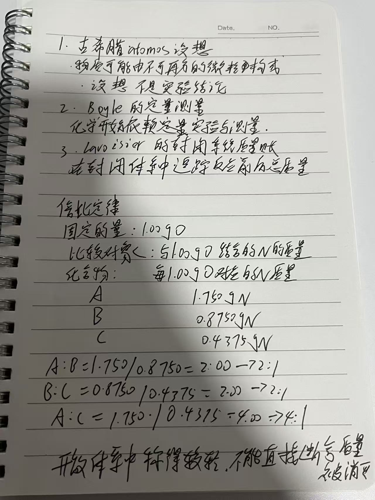
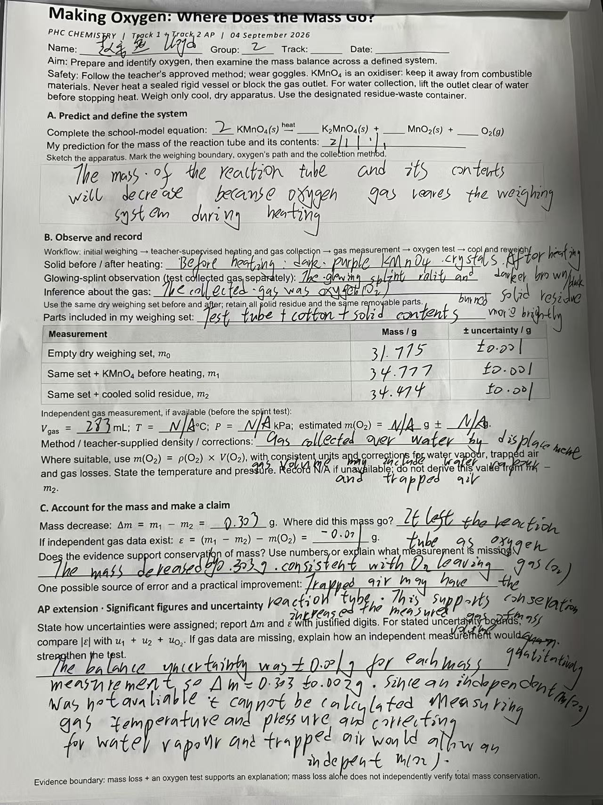

# Lesson 7 From Atomic Ideas to Conservation of Mass Learning Journal

## Purpose

This independent Journal records my learning about the difference between an atomic idea and testable quantitative evidence, the role of a closed system in conservation of mass, and the evidence for definite and multiple proportions.

The primary source is Zumdahl, *Chemistry*, 9th Edition, Chapter 2, §2.1 *The Early History of Chemistry*, printed pp. 43–44, and §2.2 *Fundamental Chemical Laws*, printed pp. 44–46. The Khan Academy conservation-of-mass video is an auxiliary resource.

## Progress dashboard

| Topic | Next step |
| --- | --- |
| Atomic ideas and quantitative evidence | Distinguish an explanation or hypothesis from a measurement that can test it. |
| Closed systems and conservation of mass | Draw the system boundary and account for matter that leaves or enters. |
| Law of definite proportions | Use equal element mass percentages or fixed mass ratios as evidence. |
| Law of multiple proportions | Compare compounds after fixing the mass of one element. |
| Example 2.1 | Complete the mass-ratio chain using 1.750, 0.8750, and 0.4375 g. |
| Selected textbook or workbook exercises | Completed 2.37, 2.38, 2.40, and 2.41 with ratios, units, fixed quantities, or reasons recorded. |
| One-page evidence chain | Completed the atomos → Boyle → Lavoisier chain, Example 2.1 ratios, and the open-system boundary. |
| Check Out Questions | Answered all three questions with a system, ratio, or composition explanation. |

## Key knowledge and vocabulary

| Concept or term | My current explanation | Example or connection |
| --- | --- | --- |
| atomos | An early idea that matter could be divided only until reaching indivisible particles. | A historical idea, not yet a quantitative test. |
| Scientific idea or hypothesis | A proposed explanation that can be compared with observations and measurements. | Atomos proposed a picture of matter; it did not by itself provide measured evidence. |
| Quantitative evidence | Evidence based on measured numbers that can test or constrain an explanation. | Repeated mass measurements and mass ratios. |
| Qualitative observation | A description of what is seen or noticed without a numerical measurement. | A reaction appears to produce bubbles; this observation alone does not account for the mass of the gas. |
| Closed system | A defined boundary in which matter does not enter or leave during the process. | A sealed reaction container. |
| Open system | A system through which matter can cross the boundary. | In an open beaker, gas may escape and no longer be included in the measured mass. |
| Law of conservation of mass | In a closed system, total mass remains constant during a chemical reaction. | Reactants' mass equals products' mass when all matter is included. |
| Law of definite proportions | A particular pure compound contains its elements in a fixed mass ratio. | The same compound has the same element mass percentages. |
| Law of multiple proportions | If two elements form more than one compound, the masses of one element that combine with a fixed mass of the other form small whole-number ratios. | Ratios such as 2:1 or 4:1. |
| Fixed amount | The same mass of one element used as the comparison basis for different compounds. | Example 2.1 fixes oxygen at 1 g before comparing nitrogen. |
| Mass ratio | A quotient comparing two masses after the comparison basis has been made equivalent. | \(1.750\ \mathrm{g\ N}/0.8750\ \mathrm{g\ N}=2.000\), written as \(2:1\). |
| Small whole-number ratio | A ratio close to simple integers, interpreted within measurement uncertainty. | \(2:1\), \(3:1\), and \(4:1\) support a multiple-proportions pattern. |
| System boundary | The line defining what is included in the measurement or mass account. | An open beaker excludes escaping gas unless it is tracked. |

## Learning records

### Learning record — 2026-09-02 — Starting Lesson 7

#### question

现在我们需要学习这些内容

#### respond

Lesson 7 begins with a prediction about a sealed container: before calculating anything, decide whether the measured mass should change after a reaction when the system includes the container and all matter inside it. The lesson then uses quantitative measurements to distinguish historical atomic ideas from testable evidence and to develop conservation of mass, definite proportions, and multiple proportions.

#### reflection
这次记录把“现在我们需要学习这些内容”留下了一个可以继续检查的节点。这条记录是当前 Journal 中较早的一次记录，暂时没有更早的同类条目可比较。本条记录中写到：Lesson 7 begins with a prediction about a sealed container: before calculating anything, decide whether the measured mass should change after a reaction when the system includes the contain…。这条记录目前没有找到可直接对应的结构化 Evidence，所以这里只依据 Journal 原文，不把结果说得比原记录更多。现在能不能算稳定，仍要看下一次独立回答，不能只因为看过解释或写过一次就下结论。下一次不看资料重新回答原问题“现在我们需要学习这些内容”，并补一个例子、计算或步骤；如果答不完整，就把缺的那一步单独记下来。

### Learning record — 2026-09-02 — Prediction for a sealed reaction

#### question

#### respond

我的预测是“保持不变”。这个预测在系统边界包括密封容器和全部内容物时是正确的：物质可以发生重新排列，但没有物质离开或进入，所以反应前后的总质量应保持不变。

#### reflection
这次记录把“”留下了一个可以继续检查的节点。回看前一条“Learning record — 2026-09-02 — Starting Lesson 7”，当时记录的是“Lesson 7 begins with a prediction about a sealed container: before calculating anything, …”。本条记录中写到：我的预测是“保持不变”。这个预测在系统边界包括密封容器和全部内容物时是正确的：物质可以发生重新排列，但没有物质离开或进入，所以反应前后的总质量应保持不变。。这条记录目前没有找到可直接对应的结构化 Evidence，所以这里只依据 Journal 原文，不把结果说得比原记录更多。现在能不能算稳定，仍要看下一次独立回答，不能只因为看过解释或写过一次就下结论。下一次不看资料重新回答原问题“”，并补一个例子、计算或步骤；如果答不完整，就把缺的那一步单独记下来。

### Learning record — 2026-09-02 — Apparent mass loss in an open beaker

#### question

#### respond

我的回答是“否，因为可能部分反应物变成了气体释放到了空气中”。这说明敞口烧杯内的测量质量变小，可能是气体离开了称量范围，而不是质量真正消失。

如果只称量烧杯和其中剩下的物质，测到的只是系统的一部分。要检验质量守恒，应把边界扩大为“烧杯 + 反应物 + 液体或固体生成物 + 逸出气体 + 其他可能离开烧杯的物质”，比较这个完整系统反应前后的总质量。

#### reflection
这次记录把“”留下了一个可以继续检查的节点。回看前一条“Learning record — 2026-09-02 — Prediction for a sealed reaction”，当时记录的是“我的预测是“保持不变”。这个预测在系统边界包括密封容器和全部内容物时是正确的：物质可以发生重新排列，但没有物质离开或进入，所以反应前后的总质量应保持不变。”。本条记录中写到：我的回答是“否，因为可能部分反应物变成了气体释放到了空气中”。这说明敞口烧杯内的测量质量变小，可能是气体离开了称量范围，而不是质量真正消失。 如果只称量烧杯和其中剩下的物质，测到的只是系统的一部分。要检验质量守恒，应把边界扩大为“烧杯 + 反应物 + 液体或固体生成物 + 逸出气体 + 其他可能离开烧杯的物质”，比较这个完整系统反应前后的总质量。。这条记录目前没有找到可直接对应的结构化 Evidence，所以这里只依据 Journal 原文，不把结果说得比原记录更多。现在能不能算稳定，仍要看下一次独立回答，不能只因为看过解释或写过一次就下结论。下一次不看资料重新回答原问题“”，并补一个例子、计算或步骤；如果答不完整，就把缺的那一步单独记下来。

### Learning record — 2026-09-02 — Tracking all matter in the system

#### question

#### respond

我的回答是“应该包括所有物质的去向的跟踪和收集”。这抓住了验证质量守恒的关键：需要追踪并收集反应物、生成物以及逸出气体，不能只称量反应后留在烧杯里的部分。

#### reflection
这次记录把“”留下了一个可以继续检查的节点。回看前一条“Learning record — 2026-09-02 — Apparent mass loss in an open beaker”，当时记录的是“我的回答是“否，因为可能部分反应物变成了气体释放到了空气中”。这说明敞口烧杯内的测量质量变小，可能是气体离开了称量范围，而不是质量真正消失。 如果只称量烧杯和其中剩下的物质，测到…”。本条记录中写到：我的回答是“应该包括所有物质的去向的跟踪和收集”。这抓住了验证质量守恒的关键：需要追踪并收集反应物、生成物以及逸出气体，不能只称量反应后留在烧杯里的部分。。这条记录目前没有找到可直接对应的结构化 Evidence，所以这里只依据 Journal 原文，不把结果说得比原记录更多。现在能不能算稳定，仍要看下一次独立回答，不能只因为看过解释或写过一次就下结论。下一次不看资料重新回答原问题“”，并补一个例子、计算或步骤；如果答不完整，就把缺的那一步单独记下来。

### Learning record — 2026-09-03 — Calculating a mass ratio

#### question

怎么算

#### respond

计算质量比就是用化合物 A 中氮的质量除以化合物 B 中氮的质量：

\[
\frac{1.750\ \text{g N}}{0.8750\ \text{g N}}
\]

因为 $0.8750\times2=1.750$，所以这个除法的结果是 $2.000$；两个相同的单位 g N 相除后被消去，质量比没有单位。按倍比定律比较时，把它写成小整数比 $2:1$。

#### reflection
这次记录把“怎么算”留下了一个可以继续检查的节点。回看前一条“Learning record — 2026-09-02 — Tracking all matter in the system”，当时记录的是“我的回答是“应该包括所有物质的去向的跟踪和收集”。这抓住了验证质量守恒的关键：需要追踪并收集反应物、生成物以及逸出气体，不能只称量反应后留在烧杯里的部分。”。本条记录中写到：计算质量比就是用化合物 A 中氮的质量除以化合物 B 中氮的质量： \[ \frac{1.750\ \text{g N}}{0.8750\ \text{g N}} \] 因为 $0.8750\times2=1.750$，所以这个除法的结果是 $2.000$；两个相同的单位 g N 相除后被消去，质量比没有单位。按倍比定律比较时，把它写成小整数比 $2:1$。。这条记录目前没有找到可直接对应的结构化 Evidence，所以这里只依据 Journal 原文，不把结果说得比原记录更多。现在能不能算稳定，仍要看下一次独立回答，不能只因为看过解释或写过一次就下结论。下一次不看资料重新回答原问题“怎么算”，并补一个例子、计算或步骤；如果答不完整，就把缺的那一步单独记下来。

### Learning record — 2026-09-03 — One-page evidence chain and Example 2.1

#### question

为什么 atomos 只是“设想”，不能直接算作科学证据？
Boyle 和 Lavoisier 的作用有什么不同？

#### respond

Atomos 是关于物质由不可分粒子组成的解释，但当时没有定量测量来检验它，所以它还是设想，不是已经被证明的科学证据。Boyle 的工作把研究推进到用实验和测量约束解释；Lavoisier 则用封闭系统记录反应前后的总质量。我的证据链是：古希腊 atomos 设想 → Boyle 的定量测量 → Lavoisier 的封闭系统质量账。

Example 2.1 固定的是每个化合物中的 $1.00\ \mathrm{g}$ 氧，比较与它结合的氮的质量：A 为 $1.750\ \mathrm{g}$，B 为 $0.8750\ \mathrm{g}$，C 为 $0.4375\ \mathrm{g}$。三个质量比为

$$
\frac{A}{B}=\frac{1.750\ \text{g N}}{0.8750\ \text{g N}}=2.000\approx2:1
$$

$$
\frac{B}{C}=\frac{0.8750\ \text{g N}}{0.4375\ \text{g N}}=2.000\approx2:1
$$

$$
\frac{A}{C}=\frac{1.750\ \text{g N}}{0.4375\ \text{g N}}=4.000\approx4:1
$$

单位 $\mathrm{g\ N}$ 相除后消去，得到没有单位的质量比。2:1 和 4:1 都是小的整数比，所以这些数据支持倍比定律。我的边界是：如果在开放体系中称得较轻，可能是气体离开了称量范围；必须追踪并收集所有物质，不能直接断言质量被消灭。

我的手写一页证据链记录如下：

#### reflection
这次记录把“为什么 atomos 只是“设想”，不能直接算作科学证据？ Boyle 和 Lavoisier 的作用有什么不同？”留下了一个可以继续检查的节点。回看前一条“Learning record — 2026-09-03 — Calculating a mass ratio”，当时记录的是“计算质量比就是用化合物 A 中氮的质量除以化合物 B 中氮的质量： \[ \frac{1.750\ \text{g N}}{0.8750\ \text{g N}} \] 因为 $…”。本条记录中写到：Atomos 是关于物质由不可分粒子组成的解释，但当时没有定量测量来检验它，所以它还是设想，不是已经被证明的科学证据。Boyle 的工作把研究推进到用实验和测量约束解释；Lavoisier 则用封闭系统记录反应前后的总质量。我的证据链是：古希腊 atomos 设想 → Boyle 的定量测量 → Lavoisier 的封闭系统质量账。 Example 2.1 固定的是每个化合…。这条记录目前没有找到可直接对应的结构化 Evidence，所以这里只依据 Journal 原文，不把结果说得比原记录更多。现在能不能算稳定，仍要看下一次独立回答，不能只因为看过解释或写过一次就下结论。下一次不看资料重新回答原问题“为什么 atomos 只是“设想”，不能直接算作科学证据？ Boyle 和 Lavoisier 的作用有什么不同？”，并补一个例子、计算或步骤；如果答不完整，就把缺的那一步单独记下来。

### Learning record — 2026-09-03 — From an idea to testable evidence

#### question

如果 atomos 说物质由不可分的粒子组成，为什么还不能直接说它是科学定律？
Boyle 和 Lavoisier 的作用有什么不同？

#### respond

“说得通”不等于“已经被测量证明”。一个科学解释至少要能提出可检验的预测，还要接受实验数据的限制。

我现在的理解是，Boyle 代表把物质研究推进到实验和定量测量；Lavoisier 则把反应前后的物质放进质量账中，并强调必须明确系统边界。于是，“质量变小”不能脱离边界解释：如果气体跑出敞口烧杯，烧杯内的读数可以变小，但完整系统的总质量并没有因此证明被消灭。

我的判断顺序是：先写出解释或预测 → 再定义测量系统 → 收集所有相关数据 → 比较数据是否支持原来的解释 → 如果不符合，就修订解释。这样可以把历史上的想法和现代可检验的证据区分开。

#### reflection
这次记录把“如果 atomos 说物质由不可分的粒子组成，为什么还不能直接说它是科学定律？ Boyle 和 Lavoisier 的作用有什么不同？”留下了一个可以继续检查的节点。回看前一条“Learning record — 2026-09-03 — One-page evidence chain and Example 2.1”，当时记录的是“Atomos 是关于物质由不可分粒子组成的解释，但当时没有定量测量来检验它，所以它还是设想，不是已经被证明的科学证据。Boyle 的工作把研究推进到用实验和测量约束解释；Lavo…”。本条记录中写到：“说得通”不等于“已经被测量证明”。一个科学解释至少要能提出可检验的预测，还要接受实验数据的限制。 我现在的理解是，Boyle 代表把物质研究推进到实验和定量测量；Lavoisier 则把反应前后的物质放进质量账中，并强调必须明确系统边界。于是，“质量变小”不能脱离边界解释：如果气体跑出敞口烧杯，烧杯内的读数可以变小，但完整系统的总质量并没有因此证明被消灭。 我的判断顺序是：…。这条记录目前没有找到可直接对应的结构化 Evidence，所以这里只依据 Journal 原文，不把结果说得比原记录更多。现在能不能算稳定，仍要看下一次独立回答，不能只因为看过解释或写过一次就下结论。下一次不看资料重新回答原问题“如果 atomos 说物质由不可分的粒子组成，为什么还不能直接说它是科学定律？ Boyle 和 Lavoisier 的作用有什么不同？”，并补一个例子、计算或步骤；如果答不完整，就把缺的那一步单独记下来。

### Learning record — 2026-09-03 — Why the comparison amount must be fixed

#### question

为什么不能直接把不同化合物里氮的质量相除？
固定的量是什么？单位有没有消掉？这个比值是在比较什么？

#### respond

如果两份数据中氧的质量不同，那么氮的质量也受到样品基准不同的影响，直接相除不一定是在比较同样条件。

Example 2.1 已经把每个化合物中的氧固定为 \(1.00\ \mathrm{g}\)，所以 A、B、C 的氮质量可以直接比较。比如 A 和 B 的比较是

$$
\frac{1.750\ \mathrm{g\ N}}{0.8750\ \mathrm{g\ N}}=2.000\approx2:1
$$

这不是说所有物质都含有相同质量的氮，而是说在相同的 \(1.00\ \mathrm{g}\) 氧的基准下，A 中结合的氮约为 B 的两倍。B 和 C 也是 \(2:1\)，A 和 C 是 \(4:1\)。因此，这些比值形成有规律的小整数关系，才成为倍比定律的证据。

如果没有写清楚固定量、单位是否消去以及比值比较的对象，就算算出一个数字，也还没有完成解释。

#### reflection
这次记录把“为什么不能直接把不同化合物里氮的质量相除？ 固定的量是什么？单位有没有消掉？这个比值是在比较什么？”留下了一个可以继续检查的节点。回看前一条“Learning record — 2026-09-03 — From an idea to testable evidence”，当时记录的是““说得通”不等于“已经被测量证明”。一个科学解释至少要能提出可检验的预测，还要接受实验数据的限制。 我现在的理解是，Boyle 代表把物质研究推进到实验和定量测量；Lavoisi…”。原来的反思已经指出：修正后，解题必须先找固定量，再写带单位的质量比，最后把接近的小数比解释成小整数比；不能只写 \(2\) 或 \(4\)。。这条记录目前没有找到可直接对应的结构化 Evidence，所以这里只依据 Journal 原文，不把结果说得比原记录更多。现在能不能算稳定，仍要看下一次独立回答，不能只因为看过解释或写过一次就下结论。下一次不看资料重新回答原问题“为什么不能直接把不同化合物里氮的质量相除？ 固定的量是什么？单位有没有消掉？这个比值是在比较什么？”，并补一个例子、计算或步骤；如果答不完整，就把缺的那一步单独记下来。

### Learning record — 2026-09-03 — Exercises 2.37 and 2.38

#### question

Exercise 2.37：肼、氨和叠氮化氢都只含氮和氢；每 \(1.00\ \mathrm{g\ N}\) 分别结合 \(1.44\times10^{-1}\ \mathrm{g\ H}\)、\(2.16\times10^{-1}\ \mathrm{g\ H}\) 和 \(2.40\times10^{-2}\ \mathrm{g\ H}\)。这些数据怎样说明倍比定律？

Exercise 2.38：两个各为 \(100.0\ \mathrm{g}\) 的碳氧化合物，一个含 \(27.2\ \mathrm{g\ C}\)，另一个含 \(42.9\ \mathrm{g\ C}\)。为什么 \(42.9\) 不是 \(27.2\) 的整数倍时，这些数据仍能支持倍比定律？

#### respond

教材：Zumdahl, *Chemistry*, 9th Edition, Chapter 2, Exercises 2.37 and 2.38, printed p. 74。

**Exercise 2.37 的解题：**我固定氮为 \(1.00\ \mathrm{g}\)，所以直接比较氢的质量：

$$
\frac{0.144}{0.216}=0.667\approx\frac{2}{3},\qquad
\frac{0.144}{0.0240}=6.00=\frac{6}{1},\qquad
\frac{0.216}{0.0240}=9.00=\frac{9}{1}
$$

每个比值中的单位都是 $\mathrm{g\ H}/\mathrm{g\ H}$，所以消去。它们可以写成小整数比 $2:3$、$6:1$ 和 $9:1$，支持倍比定律。我的修订是：不能只把三个数字并排比较，必须说明固定的是 $1.00\ \mathrm{g\ N}$。

**Exercise 2.38 的解题：**不能直接用 $42.9/27.2$，因为两个样品中的氧质量不同。先求氧的质量：

$$
m_{\text{O,1}}=100.0-27.2=72.8\ \text{g O},\qquad
m_{\text{O,2}}=100.0-42.9=57.1\ \text{g O}
$$

固定氧的质量后，比较每 $1\ \mathrm{g\ O}$ 对应的碳质量：

$$
\frac{(42.9\ \text{g C})/(57.1\ \text{g O})}{(27.2\ \text{g C})/(72.8\ \text{g O})}=2.01\approx2:1
$$

这里的单位化简为无量纲比，结果接近 $2:1$，因此支持倍比定律。我的修订是：比较两种化合物时要先固定同一种元素的质量，不能只比较两个原始样品中的碳质量。

#### reflection
这次记录把“Exercise 2.37：肼、氨和叠氮化氢都只含氮和氢；每 \(1.00\ \mathrm{g\ N}\) 分别结合 \(1.44\times10^{-1}\ \mathrm{…”留下了一个可以继续检查的节点。回看前一条“Learning record — 2026-09-03 — Why the comparison amount must be fixed”，当时记录的是“如果两份数据中氧的质量不同，那么氮的质量也受到样品基准不同的影响，直接相除不一定是在比较同样条件。 Example 2.1 已经把每个化合物中的氧固定为 \(1.00\ \mat…”。本条记录中写到：教材：Zumdahl, *Chemistry*, 9th Edition, Chapter 2, Exercises 2.37 and 2.38, printed p. 74。 **Exercise 2.37 的解题：**我固定氮为 \(1.00\ \mathrm{g}\)，所以直接比较氢的质量： $$ \frac{0.144}{0.216}=0.667\approx\fra…。这条记录目前没有找到可直接对应的结构化 Evidence，所以这里只依据 Journal 原文，不把结果说得比原记录更多。现在能不能算稳定，仍要看下一次独立回答，不能只因为看过解释或写过一次就下结论。下一次不看资料重新回答原问题“Exercise 2.37：肼、氨和叠氮化氢都只含氮和氢；每 \(1.00\ \mathrm{g\ N}\) 分别结合 \(1.44\times10^{-1}\ \mathrm{g\ H}\)、\(2.16\times10^{-1}\ \…”，并补一个例子、计算或步骤；如果答不完整，就把缺的那一步单独记下来。

### Learning record — 2026-09-03 — Exercises 2.40 and 2.41

#### question

Exercise 2.40：元素 R 和 Q 形成两种二元化合物。第一种中 \(14.0\ \mathrm{g\ R}\) 与 \(3.00\ \mathrm{g\ Q}\) 化合，第二种中 \(7.00\ \mathrm{g\ R}\) 与 \(4.50\ \mathrm{g\ Q}\) 化合。证明它们符合倍比定律；如果第二种化学式为 RQ，求第一种化学式。

Exercise 2.41：用 Dalton 原子理论解释水分解图示 \(2\mathrm{H_2O}\rightarrow2\mathrm{H_2}+\mathrm{O_2}\) 如何说明质量守恒定律。

#### respond

教材：Zumdahl, *Chemistry*, 9th Edition, Chapter 2, Exercises 2.40 and 2.41, printed pp. 74–75。

**Exercise 2.40 的解题：**固定 Q 的质量，先比较每 $1\ \mathrm{g\ Q}$ 所对应的 R：

$$
\left(\frac{14.0\ \text{g R}}{3.00\ \text{g Q}}\right)
\div
\left(\frac{7.00\ \text{g R}}{4.50\ \text{g Q}}\right)
=\frac{4.667}{1.556}=3.00=3:1
$$

单位 $\mathrm{g\ R}/\mathrm{g\ Q}$ 在相除时消去。这个 $3:1$ 是小整数比，所以符合倍比定律。如果第二种化合物的化学式是 RQ，那么第一种化合物相对于相同 Q 含有三倍的 R，第一种化合物的式子为 $R_3Q$。我的修订是：不能把 $14.0/7.00=2$ 当成答案，因为两个化合物中 Q 的质量也不同。

**Exercise 2.41 的解题：**反应前有 4 个氢原子和 2 个氧原子；反应后仍有 4 个氢原子和 2 个氧原子，只是原子的组合方式改变了。因此，在把所有物质都包括在系统中时，原子没有被创造或消灭，质量守恒。我的系统边界应包括反应容器及反应前后的全部物质；这题的理由不是“看起来一样”，而是逐个追踪原子数没有改变。
#### reflection
这次记录把“Exercise 2.40：元素 R 和 Q 形成两种二元化合物。第一种中 \(14.0\ \mathrm{g\ R}\) 与 \(3.00\ \mathrm{g\ Q}\) 化…”留下了一个可以继续检查的节点。回看前一条“Learning record — 2026-09-03 — Exercises 2.37 and 2.38”，当时记录的是“教材：Zumdahl, *Chemistry*, 9th Edition, Chapter 2, Exercises 2.37 and 2.38, printed p. 74。 …”。本条记录中写到：教材：Zumdahl, *Chemistry*, 9th Edition, Chapter 2, Exercises 2.40 and 2.41, printed pp. 74–75。 **Exercise 2.40 的解题：**固定 Q 的质量，先比较每 $1\ \mathrm{g\ Q}$ 所对应的 R： $$ \left(\frac{14.0\ \text{g R}}{…。这条记录目前没有找到可直接对应的结构化 Evidence，所以这里只依据 Journal 原文，不把结果说得比原记录更多。现在能不能算稳定，仍要看下一次独立回答，不能只因为看过解释或写过一次就下结论。下一次不看资料重新回答原问题“Exercise 2.40：元素 R 和 Q 形成两种二元化合物。第一种中 \(14.0\ \mathrm{g\ R}\) 与 \(3.00\ \mathrm{g\ Q}\) 化合，第二种中 \(7.00\ \mathrm{g\ R}\)…”，并补一个例子、计算或步骤；如果答不完整，就把缺的那一步单独记下来。

### Learning record — 2026-09-06 — Making Oxygen mass record

#### question

将这两张图片放到journal中合适的位置

#### respond

这张图片是 2026 年 09 月 04 日的 “Making Oxygen: Where Does the Mass Go?” 实验数据页。记录了高锰酸钾受热制氧、固体加热前后的质量、气体体积、荧光木条检验和误差分析。它放在本化学 Journal 的实验记录部分，作为质量变化、系统边界与证据判断的原始记录。

#### reflection
这次记录把“将这两张图片放到journal中合适的位置”留下了一个可以继续检查的节点。回看前一条“Learning record — 2026-09-03 — Exercises 2.40 and 2.41”，当时记录的是“教材：Zumdahl, *Chemistry*, 9th Edition, Chapter 2, Exercises 2.40 and 2.41, printed pp. 74–…”。原来的反思已经指出：图片中的数据支持“有氧气离开称量系统”的解释，但仅凭质量减少不能独立证明质量守恒；还需要把逸出的气体纳入系统并进行独立测量。。这条记录目前没有找到可直接对应的结构化 Evidence，所以这里只依据 Journal 原文，不把结果说得比原记录更多。现在能不能算稳定，仍要看下一次独立回答，不能只因为看过解释或写过一次就下结论。下一次不看资料重新回答原问题“将这两张图片放到journal中合适的位置”，并补一个例子、计算或步骤；如果答不完整，就把缺的那一步单独记下来。

checkoutquestions:
1. 某反应在敞口烧杯中进行，反应后烧杯内质量变小。这个结果是否证明质量守恒失效？画出你需要界定的系统，并说明还要追踪什么。
answer:
我的回答是“否，因为可能部分反应物变成了气体释放到了空气中”。
我的回答是“应该包括所有物质的去向的跟踪和收集”。系统边界应扩大到包括烧杯、反应物、生成物和逸出的气体；还要追踪并收集所有物质。

2. 化合物A中，每1.00 g氧结合1.750 g氮；B中每1.00 g氧结合0.8750 g氮。计算质量比并判断是否符合倍比定律；写出你固定的量。
answer:
我固定的是每个化合物中的 $1.00\ \mathrm{g}$ 氧。氮的质量比为 $1.750\ \mathrm{g}/0.8750\ \mathrm{g}=2.000\approx2:1$，单位消去。因为是小整数比，所以符合倍比定律。

3. 同一种纯化合物的两份样品质量分别不同，但元素质量百分比相同。这个现象支持哪条定律？它本身能否唯一给出化学式？解释。
answer:
这个现象支持定比定律，因为同一种纯化合物中各元素的质量比例固定，所以样品总质量不同，元素质量百分比仍然相同。它本身不能唯一给出化学式，因为质量百分比只能说明组成比例，还需要元素的原子质量和化合物中的原子整数比等信息。
