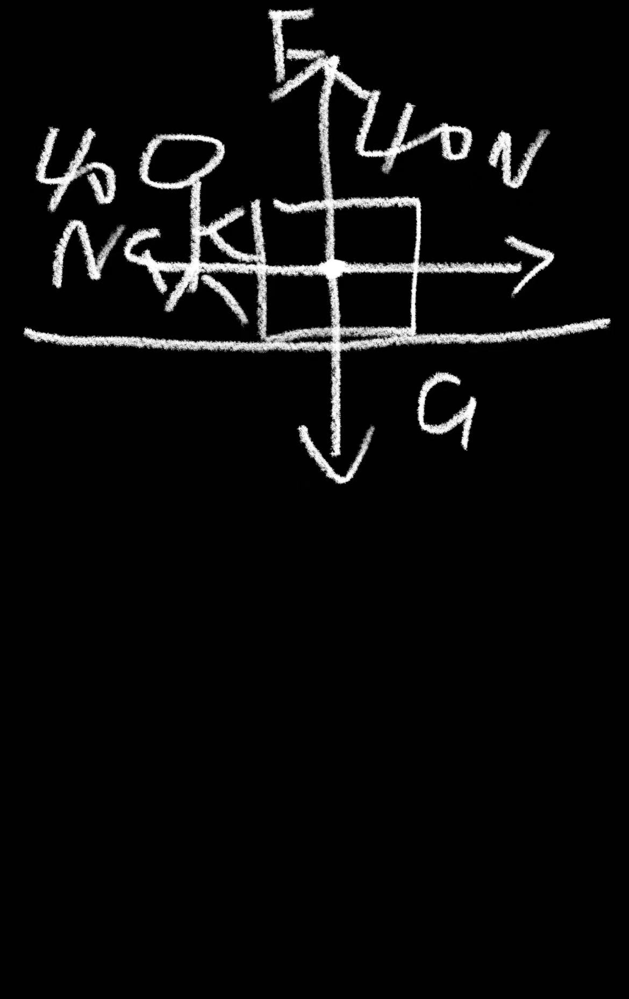
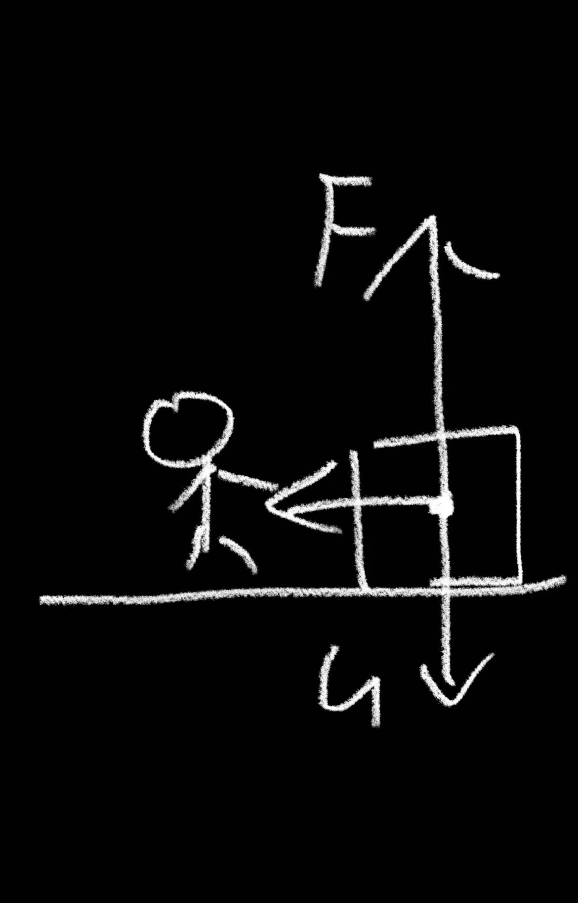

# Lesson 8: Dynamic Equilibrium and the Moving Earth Learning Journal

## Learning records

### Learning record — 2026-09-07 — Dynamic equilibrium and friction

#### question

摩擦力大小为40N，方向向左

不能，木箱会减速直到静止，合力方向向左

#### respond

During constant-speed motion, the friction force is 40 N to the left, balancing the 40 N push to the right. When the worker releases the box, the push disappears but friction remains, so the net force points left and the box slows down until it stops.

#### reflection

The learner correctly connects force balance with constant velocity and recognizes that removing the push leaves an unbalanced friction force. This is dynamic equilibrium before release and non-equilibrium after release.

### Learning record — 2026-09-08 — Checkout Question 1: static and dynamic equilibrium

#### question

静止时水平方向合力为0 匀速直线滚动时，水平方向合力为0

#### respond

The answer is correct. A stationary bowling ball is in static equilibrium, and a bowling ball moving in a straight line at constant speed is in dynamic equilibrium. In both cases, the horizontal net force is 0 N and the deciding condition is \(\sum\vec F=0\), not whether the speed is zero.

#### reflection

The learner correctly identifies the common equilibrium condition for rest and constant-velocity motion. Checkout Question 1 is complete.

### Learning record — 2026-09-08 — Checkout Question 2: force-diagram evidence and correction

#### question

摩擦力为 40N 方向向左 松手后木箱停止运动 推力消失 合力方向向右

推力消失后，剩下的摩擦力仍向左，所以合力向左。

使用这两张图

#### respond

The first answer correctly identifies the 40 N leftward friction, the box stopping after release, and the disappearance of the push. The initial net-force direction was corrected: after release, the remaining friction points left, so the net force is left. The two diagrams provide force-diagram evidence for the push/friction comparison and the vertical support-force/weight pair.

#### reflection

The learner corrected the direction of the unbalanced force and supplied the required visual evidence. Checkout Question 2 is complete with a recorded correction.

### Learning record — 2026-09-08 — Checkout Question 3: shared horizontal velocity

#### question

不知道

不会，因为墙也在运动

相对太阳的水平速度会变小，因为太阳在运动

30km/s 起跳后，没有一个力把这部分速度“清零”，墙也保留同样的水平速度，因此我不会落后于墙

因为牛顿第一定律：当物体所受合力为零时，它会保持原来的运动状态。

#### respond

The final explanation is correct. Relative to the Sun, the person keeps approximately 30 km/s of horizontal velocity after jumping because no force suddenly removes it. The wall keeps the same horizontal velocity, so the person does not fall behind it. This uses Newton’s first law: when the net force is zero, an object maintains its original state of motion. The earlier idea that the speed becomes smaller because the Sun is moving confused the reference frame with a change in velocity.

#### reflection

The learner moved from not knowing the explanation to correctly using shared horizontal velocity, inertia, and Newton’s first law. Checkout Question 3 is complete.

### Learning record — 2026-09-08 — Review of Units 1–3: knowledge list

#### question

第 1–3 单元知识点清单或思维导图 帮我完成并放入journal

#### respond

## Units 1–3 knowledge list

### Unit 1 — Science, measurement, and models

- 科学知识来自观察、测量、推理和可检验的解释；观察到的事实与推测出的解释要区分。
- 物理模型是对真实系统的简化，用来建立关系、作出预测和检验证据；模型不是现实本身。
- 测量必须写数值和单位，并考虑仪器分辨率、不确定度和有效数字。
- 先确定研究对象和系统边界，再判断哪些物质或相互作用被包括在分析中。

### Unit 2 — Motion models, forces, and equilibrium

- 亚里士多德区分自然运动和强迫运动，并认为普通物体的正常状态是静止。
- 伽利略的双斜面实验说明：摩擦越小，物体越能保持原来的运动；这支持惯性思想。
- 惯性是物体抵抗运动状态改变的性质，不是一股力。
- 牛顿第一定律：当物体所受合力为零时，静止物体保持静止，运动物体保持匀速直线运动。
- 合力是所有力的矢量和；同向相加、反向相减、互相垂直时可用勾股定理或平行四边形法则。
- 静止平衡和动态平衡都满足 \(\sum\vec F=0\)；平衡不等于没有力。
- 恒速水平运动时，推力和摩擦力可以大小相等、方向相反；推力消失后，摩擦力会造成减速。
- 物体静止在水平面上时，支持力只有在没有其他竖直力且竖直方向无加速度时才等于重力。

### Unit 3 — Linear motion and free fall

- 运动必须相对于参照物描述；同一个物体相对于不同参照物可以有不同运动状态。
- 位置描述物体在哪里；路程是实际经过的总长度；位移是有方向的位置变化。
- 速率是标量，只表示运动快慢；速度是矢量，包含大小和方向。
- 加速度是速度随时间的变化率：\(a=\frac{\Delta v}{\Delta t}\)。速度大小改变或方向改变，都可能有加速度。
- 匀加速直线运动中，\(v=v_0+at\)，位移为 \(d=v_0t+\frac12at^2\)；从静止开始时，\(d=\frac12at^2\)。
- 自由落体模型只考虑重力，忽略空气阻力；近地面可取 \(g\approx10\ \mathrm{m/s^2}\)，方向向下。
- 竖直上抛到最高点时，瞬时速度为 0，但加速度仍向下，约为 \(-10\ \mathrm{m/s^2}\)（取向上为正）。
- 空气阻力不可忽略时，合力不再只等于重力；当空气阻力与重力平衡时，物体达到终端速度。

### Connections across the three units

测量提供证据，模型把证据组织成可检验的关系；参照物决定如何描述运动，力的矢量和决定速度是否改变。判断运动状态时，不能只看物体“是否在动”，还要检查速度是否改变以及 \(\sum\vec F\) 是否为零。

#### reflection

The filtered review keeps the main concepts from Units 1–3 without repeating every tutoring exchange. It connects measurement and models with motion descriptions, force vectors, equilibrium, and free fall. The remaining assignment task is to complete four selected textbook questions from Chapter 2 Review §2.7–2.8.

### Learning record — 2026-09-08 — Selected textbook questions Q21, Q23, Q25, and Q26

#### question

1. **Q21**：保龄球静止与匀速运动是否都属于平衡？  是的，因为合力都为0
   - 对应：动态平衡
2. **Q23**：木箱受到 \\(100\\text{ N}\\) 推力并匀速滑动，摩擦力多大？  摩擦力100N&#x20;
   - 对应：摩擦力
3. **Q25**：鸟相对太阳以 \\(30\\text{ km/s}\\) 运动，落地后速度是否变为零？  是 因为它落地了
   - 对应：运动的地球、共享速度
4. **Q26**：人和墙都相对太阳以 \\(30\\text{ km/s}\\) 运动，脚离地后是否保持速度？  是的，因为存在惯性
   - 对应：惯性、牛顿第一定律

#### respond

Q21 is correct: both rest and constant-speed straight-line motion can be equilibrium because the net force is 0. Q23 is correct: if the crate moves at constant velocity while pushed with 100 N, friction is 100 N in the opposite direction. Q25 is incorrect or ambiguous: the bird still moves at approximately 30 km/s relative to the Sun after reaching the ground, because it shares Earth’s horizontal velocity; landing does not make its Sun-relative speed zero. Q26 is correct: after the feet leave the ground, the person approximately maintains the shared horizontal velocity because of inertia and Newton’s first law. Assessment: Q21 10/10, Q23 10/10, Q25 3/10, Q26 10/10; overall 8.25/10.

#### reflection

The learner correctly understands dynamic equilibrium, friction, and inertia in Q21, Q23, and Q26. Q25 reveals a reference-frame mistake: “落地” describes contact with the ground, but it does not mean the bird’s velocity relative to the Sun becomes zero. The four-question assignment is partly complete; Q25 needs a corrected answer and explanation.

### Learning record — 2026-09-08 — Q25 corrected speed relative to the Sun

#### question

鸟落地后相对太阳仍近似以30km/s运动

因为鸟和地面共享相同的水平速度，惯性使鸟保持这部分速度。

#### respond

The conclusion and explanation are correct: after landing, the bird still moves at approximately 30 km/s relative to the Sun because the bird and the ground share the same horizontal velocity, and inertia preserves that component of motion. Assessment: 10/10.

#### reflection

The learner corrected the main reference-frame error in Q25 and connected the result to shared horizontal velocity and inertia. The selected four-question assignment is now complete.

## Concepts to revisit

- Static equilibrium: an object is at rest and \(\sum \vec F=0\).
- Dynamic equilibrium: an object moves at constant velocity and \(\sum \vec F=0\).
- During constant-speed horizontal motion, the push and friction can be equal and opposite.
- When the push stops, friction can produce a net force and slow the object.
- Objects on Earth share Earth’s horizontal velocity; inertia explains why jumping does not make the ground move away underneath you.

## Mistakes and corrections

| Date | Topic | Mistake | Correction |
|---|---|---|---|
| 2026-09-08 | Net force after release | Initially said the net force pointed right after the rightward push disappeared. | The remaining friction points left, so the net force points left. |
| 2026-09-08 | Moving Earth reference frame | Thought the horizontal speed became smaller because the Sun was moving. | In the Sun reference frame, the person keeps approximately 30 km/s horizontal velocity by inertia. |

## checkoutquestions:

1. 保龄球静止在地面上处于平衡。若它沿直线以恒定速率滚动，是否仍处于平衡？判断依据是速度为零，还是 $$\sum\vec F=$$？分别写出两种情况下水平方向的合力。
answer: 静止时水平方向合力为0 匀速直线滚动时，水平方向合力为0

2. 工人用 40 N 的水平力推木箱，木箱沿水平地面匀速前进。木箱受到的摩擦力是多少、方向如何？若工人突然松手，木箱能否继续匀速？用受力图说明哪一个力不再被平衡。
answer: 摩擦力为 40N 方向向左 松手后木箱停止运动 推力消失 合力方向向右
correction: 推力消失后，剩下的摩擦力仍向左，所以合力向左。

3. 你站在相对太阳约 30 km/s 运动的地面上跳起。跳起后你相对太阳的水平速度是否突然变为零？墙壁为什么不会在你落地前“撞上”你？指出这条论证用了牛顿第一定律的哪一句，而不是“有一股力把你带着走”。
answer: 30km/s 起跳后，没有一个力把这部分速度“清零”，墙也保留同样的水平速度，因此我不会落后于墙
correction: 因为牛顿第一定律：当物体所受合力为零时，它会保持原来的运动状态。
