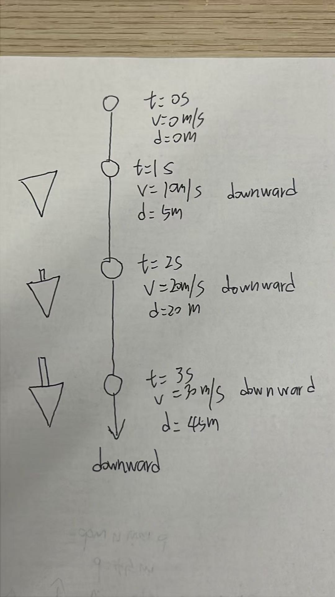

# Physics Chapter 3 Learning Journal

## Unit purpose

This Unit Journal records my learning about linear motion: reference frames, speed, velocity, and acceleration. It keeps the detailed explanations, examples, mistakes, and corrections for Chapter 3 separate from the Physics subject overview.

## Progress dashboard

| Topic | Last updated | Next step |
| --- | --- | --- |
| Relative motion | 2026-08-25 | Complete the selected textbook questions. |
| Speed and velocity | 2026-08-25 | Complete the selected textbook questions. |
| Acceleration and free fall | 2026-08-26 | Review terminal velocity and the limits of the free-fall model. |

## Key knowledge and vocabulary

| Concept or term | My current explanation | Example or connection |
| --- | --- | --- |
| Relative motion | Motion is described relative to a reference point. | I am stationary relative to a train seat but moving relative to the ground. |
| Speed | A scalar quantity describing how fast an object moves. | $5\ \text{m/s}$ gives a magnitude but no direction. |
| Velocity | A vector quantity describing speed and direction. | $5\ \text{m/s}$ east includes both magnitude and direction. |
| Acceleration | The rate at which velocity changes with time. | Turning at constant speed still produces acceleration because direction changes. |

## Learning records

- <a href="{{ '/physics/lesson-4-aristotle-velocity-vectors/' | relative_url }}">Lesson 4: From Aristotle to Velocity Vectors Learning Journal</a>

- <a href="#questions-selected">Questions Selected</a>

### Learning record — 2026-08-25 — Relative motion, speed, velocity, and acceleration

#### question

now we need to learn about:Conceptual Physics：P39-46
3.1 motion is relative
3.2 speed
3.3 velocity
3.4 acceleration

#### respond

Paul G. Hewitt, *Conceptual Physics*, Twelfth Edition, pages 39–46; Khan Academy High School Physics, Unit 1, Lesson 1: Describing Motion; Check Out Questions and follow-up practice.

1. **Motion is relative.** If I sit in a moving high-speed train, I am stationary relative to the carriage but moving relative to the ground.

2. **Speed and velocity are different.** Speed describes only how fast an object moves and is a scalar. Velocity describes how fast an object moves and its direction, so it is a vector. An object running one lap at constant speed on a circular track has changing velocity because its direction changes continuously.

3. **Acceleration describes the change in velocity over time.** An object can have acceleration even when its speed stays constant, because a change in direction changes its velocity. A bicycle turning around a corner is an example.

The train example changes depending on the reference frame. The circular-track example shows that constant speed does not mean constant velocity. A bicycle turning at nearly constant speed shows that changing direction produces acceleration.

Motion must be described relative to a reference point. Speed is the magnitude of motion without direction, while velocity includes both magnitude and direction. Acceleration is the rate of change of velocity, so speeding up, slowing down, and turning can all be acceleration.

The unit $\text{m/s}$ does not contain direction; it can be used for both speed and velocity. Velocity includes direction as additional information. Since acceleration depends on the change in velocity, a direction change produces acceleration even when speed is constant.

#### reflection
这次记录把“now we need to learn about:Conceptual Physics：P39-46 3.1 motion is relative 3.2 speed 3.3…”留下了一个可以继续检查的节点。这条记录是当前 Journal 中较早的一次记录，暂时没有更早的同类条目可比较。本条记录中写到：Paul G. Hewitt, *Conceptual Physics*, Twelfth Edition, pages 39–46; Khan Academy High School Physics, Unit 1, Lesson 1: Describing Motion; Check Out Questions and follow-up practice. 1. **M…。系统里对应的学习证据显示：部分做到，未评分，帮助情况不明。现在能不能算稳定，仍要看下一次独立回答，不能只因为看过解释或写过一次就下结论。下一次不看资料重新回答原问题“now we need to learn about:Conceptual Physics：P39-46 3.1 motion is relative 3.2 speed 3.3 velocity 3.4 acceleration”，并补一个例子、计算或步骤；如果答不完整，就把缺的那一步单独记下来。

### Learning record — 2026-08-26 — How velocity changes in vertical motion

#### question

小球竖直上抛，到达最高点时 $$v=$$，它的加速度也等于 0 吗？ 怎么回答和解释这个问题

#### respond

Paul G. Hewitt, *Conceptual Physics*, Twelfth Edition, Chapter 3.5, printed pp. 46–50; Khan Academy, “Falling objects”; core question about a ball thrown vertically upward.

At the highest point, the ball’s instantaneous velocity is $v=0$, but gravity is still acting. If upward is positive, the acceleration remains $a\approx-10\ \mathrm{m/s^2}$. The ball’s velocity is changing from upward to downward, so its acceleration is not zero.

For a ball thrown upward at $20\ \mathrm{m/s}$, its velocity decreases by about $10\ \mathrm{m/s}$ each second: $+20$, $+10$, $0$, then $-10\ \mathrm{m/s}$. The velocity is zero for only an instant at the top, while the acceleration remains downward throughout the motion.

Velocity tells the ball’s motion at one instant. Acceleration tells how its velocity is changing. Therefore, $v=0$ at the top does not mean $a=0$; the ball is about to change from moving upward to moving downward because gravity continues to give it downward acceleration.

The important difference is not just their units. Acceleration is the rate of change of velocity. At the highest point, the velocity is momentarily zero, but it is changing, so $a=-g$, not zero.

#### reflection
这次记录把“小球竖直上抛，到达最高点时 $$v=$$，它的加速度也等于 0 吗？ 怎么回答和解释这个问题”留下了一个可以继续检查的节点。回看前一条“Learning record — 2026-08-25 — Relative motion, speed, velocity, and …”，当时记录的是“Paul G. Hewitt, *Conceptual Physics*, Twelfth Edition, pages 39–46; Khan Academy High Sch…”。本条记录中写到：Paul G. Hewitt, *Conceptual Physics*, Twelfth Edition, Chapter 3.5, printed pp. 46–50; Khan Academy, “Falling objects”; core question about a ball thrown vertically upward. At the highest p…。系统里对应的学习证据显示：部分做到，未评分，帮助情况不明。现在能不能算稳定，仍要看下一次独立回答，不能只因为看过解释或写过一次就下结论。下一次不看资料重新回答原问题“小球竖直上抛，到达最高点时 $$v=$$，它的加速度也等于 0 吗？ 怎么回答和解释这个问题”，并补一个例子、计算或步骤；如果答不完整，就把缺的那一步单独记下来。

### Learning record — 2026-08-26 — Check Out Question 1: Free fall

#### question

1.gravity2.because the mass of the feather is lower 3.idontknow

#### respond

Conceptual Physics, Chapter 3.5, pp. 46–50; Check Out Question 1.

Free fall is motion in which gravity is the only force acting on an object. The model ignores air resistance and other forces. In air, a feather falls differently because air resistance is large compared with its weight. In a vacuum, objects of different masses have the same free-fall acceleration near Earth.

A feather and a coin fall at the same acceleration in a vacuum. In ordinary air, the feather quickly experiences air resistance that significantly reduces its net downward force.

The free-fall model assumes that the object is acted on only by gravity, so the net force equals the gravitational force and $a=g$. When air resistance cannot be ignored, the object also experiences a force opposite to its motion, so the net force is no longer equal to gravity alone. The acceleration is then different from $g$, and the free-fall equations no longer describe the motion accurately. If air resistance balances gravity, the object reaches terminal velocity.

Mass does not change the ideal free-fall acceleration. The important difference in air is air resistance, especially relative to the feather’s small weight. Without air resistance, both objects accelerate at approximately $10\ \mathrm{m/s^2}$ downward.

#### reflection
这次记录把“1.gravity2.because the mass of the feather is lower 3.idontknow”留下了一个可以继续检查的节点。回看前一条“Learning record — 2026-08-26 — How velocity changes in vertical motion”，当时记录的是“Paul G. Hewitt, *Conceptual Physics*, Twelfth Edition, Chapter 3.5, printed pp. 46–50; Kh…”。本条记录中写到：Conceptual Physics, Chapter 3.5, pp. 46–50; Check Out Question 1. Free fall is motion in which gravity is the only force acting on an object. The model ignores air resistance and other forc…。系统里对应的学习证据显示：部分做到，未评分，帮助情况不明。现在能不能算稳定，仍要看下一次独立回答，不能只因为看过解释或写过一次就下结论。下一次不看资料重新回答原问题“1.gravity2.because the mass of the feather is lower 3.idontknow”，并补一个例子、计算或步骤；如果答不完整，就把缺的那一步单独记下来。

### Learning record — 2026-08-26 — Check Out Question 3: Vertical throw

#### question

1秒后小球的速度向上，到达最高点时速度方向是向上，到达最高点时加速度方向向下

#### respond

Conceptual Physics, Chapter 3.5, pp. 46–50; Check Out Question 3.

One second after being thrown upward at $20\ \mathrm{m/s}$, the ball is still moving upward, although more slowly. At the highest point, its velocity is $0$, so it has no direction at that instant. Its acceleration still points downward because gravity continues to act.

With upward positive, the velocity changes from $+20\ \mathrm{m/s}$ to $+10\ \mathrm{m/s}$, then to $0\ \mathrm{m/s}$ at the highest point. The acceleration remains $-10\ \mathrm{m/s^2}$ throughout the ideal motion.

The direction of velocity describes the direction of motion. When velocity is zero, the object is momentarily not moving, so its velocity has no direction. Acceleration can still have a direction because the velocity is about to change toward downward motion.

At the highest point, $v=0$, so velocity has no direction. The acceleration is still downward: $a=-g$.

#### reflection
这次记录把“1秒后小球的速度向上，到达最高点时速度方向是向上，到达最高点时加速度方向向下”留下了一个可以继续检查的节点。回看前一条“Learning record — 2026-08-26 — Check Out Question 1: Free fall”，当时记录的是“Conceptual Physics, Chapter 3.5, pp. 46–50; Check Out Question 1. Free fall is motion in …”。本条记录中写到：Conceptual Physics, Chapter 3.5, pp. 46–50; Check Out Question 3. One second after being thrown upward at $20\ \mathrm{m/s}$, the ball is still moving upward, although more slowly. At the h…。系统里对应的学习证据显示：部分做到，未评分，帮助情况不明。现在能不能算稳定，仍要看下一次独立回答，不能只因为看过解释或写过一次就下结论。下一次不看资料重新回答原问题“1秒后小球的速度向上，到达最高点时速度方向是向上，到达最高点时加速度方向向下”，并补一个例子、计算或步骤；如果答不完整，就把缺的那一步单独记下来。

### Learning record — 2026-08-26 — Check Out Question 2: Falling from rest

#### question

3秒末速度是向下，3秒内位移30m

#### respond

Conceptual Physics, Chapter 3.5, pp. 46–50; Check Out Question 2.

For an object released from rest with $g=10\ \mathrm{m/s^2}$ and $t=3\ \mathrm{s}$:

$$
v=v_0+gt=0+10(3)=30\ \mathrm{m/s}
$$

The 3-second displacement is:

$$
d=\frac12gt^2=\frac12(10)(3^2)=45\ \mathrm{m}
$$

The final velocity is $30\ \mathrm{m/s}$ downward, and the displacement is $45\ \mathrm{m}$ downward.

The object’s velocity at each second is $0$, $10$, $20$, and $30\ \mathrm{m/s}$. Because the velocity is changing, displacement cannot be found by using the final velocity for the entire 3-second interval.

Final velocity describes how fast the object is moving at $3\ \mathrm{s}$. Displacement describes how far it moved during the whole interval. Under constant acceleration, the object’s average velocity is $15\ \mathrm{m/s}$, so $d=15(3)=45\ \mathrm{m}$.

Use $v=v_0+gt$ for final velocity and $d=\frac12gt^2$ for displacement from rest. The units also help: velocity is in $\mathrm{m/s}$, while displacement is in $\mathrm{m}$.

#### reflection
这次记录把“3秒末速度是向下，3秒内位移30m”留下了一个可以继续检查的节点。回看前一条“Learning record — 2026-08-26 — Check Out Question 3: Vertical throw”，当时记录的是“Conceptual Physics, Chapter 3.5, pp. 46–50; Check Out Question 3. One second after being …”。本条记录中写到：Conceptual Physics, Chapter 3.5, pp. 46–50; Check Out Question 2. For an object released from rest with $g=10\ \mathrm{m/s^2}$ and $t=3\ \mathrm{s}$: $$ v=v_0+gt=0+10(3)=30\ \mathrm{m/s} $$…。系统里对应的学习证据显示：部分做到，未评分，帮助情况不明。现在能不能算稳定，仍要看下一次独立回答，不能只因为看过解释或写过一次就下结论。下一次不看资料重新回答原问题“3秒末速度是向下，3秒内位移30m”，并补一个例子、计算或步骤；如果答不完整，就把缺的那一步单独记下来。

### Learning record — 2026-10-07 — Reviewing speed, velocity, displacement, and turning motion

#### question

All right, let's review the... Physics we've learned

speed only has size ,while velocity has both direction and size

It would net force

What is a net force

What's the Chinese word for net word, net force

Alright, alright. And back to the example. And if, something moves around a curve at a steady speed, it's ...velo- veloci-... velocity... will change

But why? Can you... draw me

What's the definition... of... speed and velocity

How do we... calculate them

What is displacement

Its velocity point at... um... forward, and its... acceleration... point... left

The net force... is... points... left

If you ask... which arrow makes the speed decrease, I would say it- it's definitely... the... the the the... backward

Back left

#### respond

Speed is distance divided by time and gives magnitude only. Velocity is displacement divided by time and includes direction. Displacement is the straight-line change from the starting position to the ending position, including direction. “合力” is the Chinese term for net force; net force is the vector sum of all forces.

For motion around a curve at steady speed, the direction of velocity changes, so velocity changes and there is acceleration toward the center of the curve. The net force points inward as well. In the car example, velocity points forward along the road, while inward acceleration and net force point left during a left turn. When the car also slows, the backward acceleration component reduces its speed; with inward and backward components together, the total acceleration and net force point back-left. The learner identified “backward” as the component that reduces speed and “Back left” as the direction of the total.

#### reflection

The learner correctly distinguished speed from velocity and, after a guided direction check, identified forward velocity and leftward inward acceleration and net force for a left turn. They needed the curved-motion diagram and a simpler separation of turning from slowing down, then identified the backward component as the one that decreases speed and the combined direction as back-left. This is evidence of understanding with substantial prompting, not independent or stable mastery. Next, ask the learner to explain without a diagram why a steady-speed turn still changes velocity, then separately identify the velocity and net-force directions for a right turn.

## Concepts to revisit

- Vector components of velocity and acceleration
- Average velocity versus average speed after a complete lap
- Position-time and velocity-time graphs

## Mistakes and corrections

| Date | Topic | Mistake | Correction |
|---|---|---|---|
| 2026-08-25 | Acceleration in circular motion | I thought constant speed meant that acceleration was zero. | Direction is part of velocity, so changing direction produces acceleration even when speed is constant. |
| 2026-08-25 | Speed and velocity units | I thought $\text{m/s}$ alone had to show direction to be connected with velocity. | $\text{m/s}$ is the unit; direction is additional information in the velocity description. |
